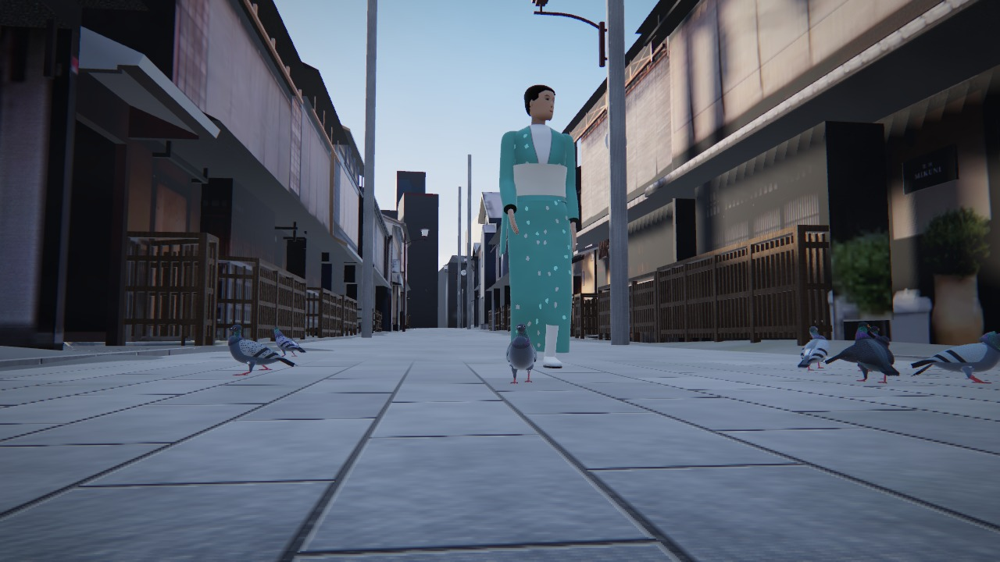
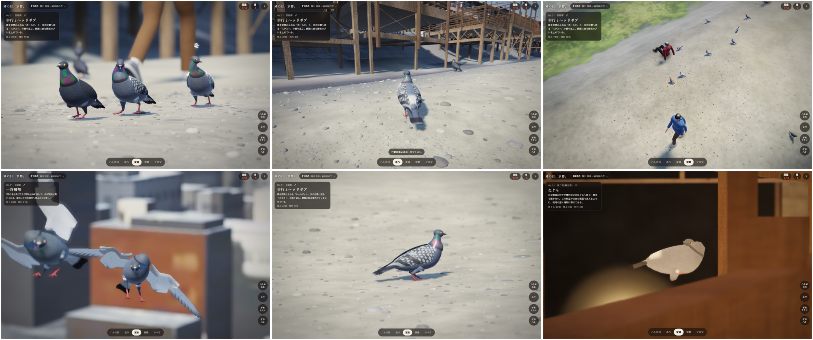
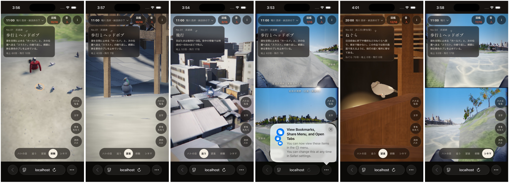

# 鳩の目、京都。

京都の先斗町・鴨川・祇園白川を、ドバトの目で歩いて飛ぶブラウザ作品です。街は国土交通省の 3D 都市モデル PLATEAU（京都市・2025 年度）から再構成しています。中心部の LOD3 建築物 138 棟を主役に、周囲を LOD2 建築物 834 棟で囲んでいます。依存ライブラリは three.js r170 だけで、ビルド工程はありません。

作品を開く: <https://claude.ai/artifact/L6dDhAnGZur167TMmp6hdM>

リンクを開くと紹介ページが出ます。最初の画面を押すと、その場で作品が始まります。



実装と検証は AI（Claude Fable 5.2）が行いました。制作と検証には Meta Muse も利用しました。出した指示、AI が下した技術判断、つまずいた点、確かめられたことと確かめられなかったことは [docs/article.md](docs/article.md) にまとめています。約 30 秒の紹介動画は [media/video/hato_kyoto_x.mp4](media/video/hato_kyoto_x.mp4) です。

## 規模

| 項目 | 値 |
| --- | --- |
| 舞台 | 先斗町・鴨川・祇園白川の約 511 m × 399 m。周囲 1.37 km × 1.33 km は簡略表示 |
| 街のポリゴン | 約 64.6 万三角形。LOD3 建築物 138 棟、LOD2 建築物 834 棟、街路設備 985 点 |
| ハト | 最大 90 羽の群れとトビ 3 羽。行動は台本なしで、空腹・渇き・時刻・周囲の動きから決まる |
| 視点 | ハトの目（左右約 320° のパノラマ）、追尾、望遠、俯瞰、シネマの 5 種 |
| 時間と天気 | 0 時から 24 時まで連続に変えられる。雨上がりの濡れた路面に切り替え可能 |
| 配信サイズ | 作品本体は 226 ファイル、約 54 MB。起動時に読むのは約 21 MB。紹介ページの画像と動画が別に 16 ファイル、約 12 MB |
| 音 | 音声ファイルなし。川音から鳴き声までブラウザ上で合成 |

## リポジトリの構成

| ディレクトリ | 内容 |
| --- | --- |
| [app/](app/) | 作品本体と紹介ページ。静的ファイルだけで動く公開ビルド（v40） |
| [pipeline/](pipeline/) | PLATEAU の 3D Tiles と地理院タイルから `app/d`・`app/t` を作る Node.js の変換パイプライン |
| [survey/](survey/) | 舞台を決めるために行った、LOD3 テクスチャ密度の調査スクリプトと結果 |
| [tools/](tools/) | 静止画と動画の撮影、動画の組み立て、ブラウザ 3 エンジンでの検証スクリプト |
| [docs/](docs/) | 記事（`article.md`）と X の投稿文案（`x-post.md`） |
| [media/](media/) | 静止画、紹介動画、動画の素材クリップ |
| [prototype/](prototype/) | 前身の大阪・日本橋版。測量データを使わない手続き生成の試作 |

## 動かす

`app/` を静的ファイルとして配信すれば動きます。ES モジュールと `fetch` を使うので、`file://` で直接開くことはできません。

```sh
python3 -m http.server 8000 --directory app
# http://localhost:8000/ を開く
```

WebGL 2 と `DecompressionStream` に対応したブラウザが必要です。画質は端末に合わせて 3 段階から自動で選ばれ、描画が間に合わないときは実行中に内部解像度を下げます。

パラメータを付けずに開くと、紹介ページが出ます。紹介ページを読んでいる間に、作品のデータを裏で先に読み込みます（起動に要るのは約 21 MB で、そのうち PC と Wi-Fi 接続では約 19 MB、そのほかのスマートフォンでは最初の約 4 MB を先に読みます。ブラウザでデータ節約を指定している場合は読みません）。作品そのものは、最初の画面を押したときに動きだします。パラメータを 1 つでも付けるか、URL の末尾に `#play` を付けると、紹介ページを出さずに作品のタイトル画面から始まります。

URL のパラメータで起動時の状態を指定できます。

| パラメータ | 例 | 内容 |
| --- | --- | --- |
| `q` | `q=low` | 画質。`low`、`mid`、`high` |
| `m` | `m=eye` | 最初の視点。`eye`（ハトの目）、`chase`（追尾）、`tele`（望遠）、`over`（俯瞰）、`cine`（シネマ） |
| `t` | `t=15.5` | 開始時刻。0 から 24 |
| `auto` | `auto=1` | タイトル画面を出さずに始める |
| `n` | `n=46` | ハトの数。2 から 240 |
| `nolife` | `nolife=1` | 人と車を出さない |
| `scale` | `scale=0.5` | 内部解像度の倍率。0.2 から 2 |
| `people` | `people=asset` | 歩く人・立つ人・座る人を、読み込んだ人体データ（Microsoft Rocketbox、MIT License）に替える。既定はコードで生成した人。約 12 MB を追加で読み込む。PC 向け |
| `tm` | `tm=agx` | トーンカーブを AgX に替える（比較用。既定は ACES の近似） |
| `seed` | `seed=7` | 乱数の種。餌場、群れの配置、行動の選択が同じ乱数源を使う。画面を描きながらの実行は 1 コマの長さが毎回違うので、同じ種でも結果は一致しない |
| `rec` | `rec=30` | 録画用の固定時間刻み（1 秒あたりのコマ数）。`tools/rec2.py` が使う |

## 公開先

作品は Claude のアーティファクトとして公開しています（冒頭のリンク）。`app/` はビルド不要の静的ファイルなので、そのまま別の静的ホスティングに置くこともできます。全体で約 66 MB（作品本体が約 54 MB、紹介ページの画像と動画が約 12 MB）、最大のファイルは約 15 MB です。アーティファクトの URL にはパラメータを渡せないので、パラメータを使うときは自分で配信してください。

`app/d` と `app/t` の `.txt` は、バイナリを base64 にしたものです。アーティファクトのホストがバイナリ拡張子を配信できないための措置で、サイズは約 33% 増えています。

## データを作り直す

`app/d` と `app/t` は、[pipeline/](pipeline/) の 6 段のパイプラインで作ったものです。入力の 3D Tiles（約 1 GB）と地理院タイルはリポジトリに含めていません。取得方法と実行手順は [pipeline/README.md](pipeline/README.md) にあります。

## 検証

実機を持たない AI が手元で確かめた範囲と、そのためのスクリプトは [tools/README.md](tools/README.md) にあります。実機でのフレームレート、耳で聴いた音の印象、実際の GPU とドライバーごとの差は確かめられていません。作品の「i」ボタンの最下段に、その端末で選ばれた画質、1 コマの平均時間、内部解像度、起動にかかった時間、音の状態と出力レベル、GPU 名が出ます。

音は、出力の波形を計測して信号が出ていることまで確かめました（ヘッドレス Chrome で −21〜−29 dB）。タップやボタンは、マウスとキーボードの実際の入力イベントで確かめています（`tools/uitest.py`、18 項目）。

描画の量は、画質「高」の望遠の視点で 1 コマ約 440 万三角形、「ハトの目」では 6 方向を描くので約 1,140 万三角形です（影や映り込みの分を含む、three.js の計測値）。非力な GPU には重い構成です。公開後に届いた 1 件のプレイ報告では、最低の内部解像度（42%）まで下がって約 20 fps でした。端末の種類は分かっておらず、こちらで確かめた値ではありません。

## できていないこと

- 季節は納涼床が出ている 10 月中旬に固定している。桜や紅葉は再現できない
- 人の顔と指は簡略で、2〜3 m まで近づくと作り物だと分かる
- LOD3 があるのは先斗町通と祇園白川沿いだけで、少し離れると LOD2 の箱形の建物になる
- LOD3 の壁の写真は、1 m 以内まで近づくとぼける。元データの解像度による
- LOD3 の道路はすべて石畳として描いている。車線として記録された区間も石畳になるので、実際の舗装とは違う可能性がある
- 川端通と四条通の車線、木の種類、橋の細部、人と車の量は推定と演出である
- ハトの数と行動の頻度は、観察しやすいように調整してある
- 遠くのハトも近くのハトと同じ細かさで描いている。重いときに下げられるのは、解像度、ぼけ、小石と草、影の更新頻度、映り込み、輪郭の補正までで、形の細かさは変わらない
- LOD2 の建物の屋根の色は空中写真から取っている。写真は真上からの正射ではないので、高い建物では位置が少しずれる
- 夜、ハトが眠る場所は街灯の届く軒先や納涼床に寄せてある。実際のねぐらの分布を調べたものではない

ハトの行動は実際のドバトの生態をもとにしていますが、観察記録と照合したものではありません。

## 更新の記録

v30（2026-11-13）では、図鑑と情報のパネルを Esc キーとパネルの外側の押下でも閉じられるようにし、図鑑の「ねぐら」の解説に、街灯の届く場所に寄せてあることを書きました。紹介ページの英文も、LOD3 と LOD2 の内訳が分かる形にしました。

v31（2026-11-13）では、届いた指摘のうち操作と保守に関わる点を直しました。情報のパネルは「操作」を先頭の箇条書きにし、データの内訳は折りたたみに移しました（出典は常に見える位置に残しています）。パネルを開くとフォーカスが中に移り、閉じると元のボタンに戻ります。パネルの文字を大きくするボタンを付けました。左上の時刻ボタンには開閉の印と読み上げ用の説明を付け、視点ボタンと「ハトになる」は押されている状態を読み上げに伝えます。タッチ端末ではボタンの高さを 44 px 以上にしました。納涼床や軒の下の地面にもエサをまけるようにしました（これまでは屋根のある場所をすべて断っていました）。水飲みと水浴びの候補になる水際は、間引かずに 78 か所すべてを持つようにしました。URL のパラメータは数値と範囲を確かめてから使います（羽数は 2〜240）。`?seed=数値` を付けると乱数の種を固定できます。紹介ページの読み込み量の注記は、接続の種類に合わせて出し分けます。モバイル回線と分かる場合は、冒頭の映像を再生しません。

v32（2026-11-13）では、行動図鑑のまだ見ていない項目に、探す場所と時間帯のヒントを出すようにしました。「ハトの目」では、両目で見えている中央の帯を、開いた最初の 2 回だけ数秒間縁どって示します。離した通知が届かなかった指が残ると以後のタップが効かなくなる問題も直しました。

v33（2026-11-13）では、実ブラウザでの確認で見つかった表示の 2 点を直しました。情報パネルの GPU 名は途中で切らずに折り返して全文を出します。視点を切り替えた直後に、選んだ視点の名前が数秒見えなくなることがあったので、文字の色はすぐに切り替えるようにしました。

v34（2026-11-14）では、タイトル画面の注記に読み込み量（約 21 MB）と動作要件（WebGL 2 と DecompressionStream）を足しました。紹介ページを経ずに作品を開いた人にも伝わるようにするためです。紹介ページには、制作と検証に Meta Muse も利用したことを追記しました。

v35（2026-11-14）では、物陰の暗さ（遮蔽）を光線追跡で焼き直しました。これまでは高さ地図からの近似で、納涼床や軒の下を表せていませんでした。街の全三角形（約 85 万）に対して、建物と設置物の頂点（約 193 万点）と地面のグリッド（0.5 m 間隔、約 88 万点）から光線を 64 本ずつ飛ばし、水平より上の方向のうち空に届く割合を求めています。計算は Rust で書いた道具（`tools/bench/bake/`）で事前に 1 回行い、結果をデータに入れてあるので、読み込み時間は変わりません（データは約 0.45 MB 増）。経緯と測定は [docs/perf-rust.md](docs/perf-rust.md) にあります。

v36（2026-11-14）では、論文を調べて 2 点を直しました。首の緑と紫は、小羽枝のケラチン層での薄膜干渉として波長ごとに計算した色に置き換え、空の映り込みと太陽の反射として出すようにしました（緑の羽は斜めから見ると紫に、紫の羽は緑に変わります）。歩くときに頭を止めている時間の割合は、速く歩くほど短くなります。調べた資料と、試して採用しなかったもの（AgX のトーンカーブ、視力のぼかし）は [docs/realism-research.md](docs/realism-research.md) にまとめています。

v40（2026-11-15）では、はじめて実際の GPU で動かし、ソフトウェア描画では出なかった不具合を 3 つ直しました。

- **カメラがハトを追っていなかった（v26 から v39 まで）**: 「追う」「望遠」「俯瞰」で、カメラは視点やハトを選んだ瞬間に一度置かれるだけで、その後は動いていませんでした。ハトへ寄せる処理が、v26 で行の途中に入れた `//` コメントの後ろに入り、コメントの一部になっていたためです。視点やハトを切り替えるたびに置き直されるので、短い確認では気づけませんでした。自動計測で「注視中のハトが画面のどこにいるか」を 1 秒ごとに記録したところ、ハトが歩いて画面の外に出てもカメラの位置が変わっていないことが数値で出ました。動作確認（#17）で報告された「望遠・俯瞰で屋根面しか映らなくなる」の主因はこれです。`tools/jscheck.sh` に、行の途中の `//` コメントの後ろにコードが続く行を検出する検査を足しました。
- **ハトの頭のあたりが黒い四角になる**: NVIDIA T4（Colab）と Apple の GPU で、被写界深度が効いている視点だけに出ました。目などの鏡面の輝きが半精度浮動小数の描画先に入りきらず無限大になり、ぼかしがそれを広げていました。すべての材質の出力を有限の範囲に収め、ぼかしとにじみの側でも数でない画素を無視するようにしました。
- **iOS の Safari で地面全体が影になる**: iOS シミュレーターの Safari は、深度の比較サンプラー（`sampler2DShadow`）に何を尋ねても 0 を返しました（デスクトップの Chrome と WebKit は正しく返します。確認用の小さな描画を計測に入れてあります）。ハトの影だけこの方式で読んでいたため、ハトの周りの地面がすべて影になっていました。深度を普通のテクスチャとして読み、シェーダーの中で比べる方式に替えました。実機の iPhone でも同じかは分かりませんが、どちらでも正しく出る書き方です。

あわせて、飛んでいるハトを望遠で追うときは屋根より上から見下ろすようにしました。

**実際の GPU での確認**（結果の全体は [docs/verification/](docs/verification/)、[#18](https://github.com/kai-kou/hato-no-me-kyoto/issues/18)）

| 環境 | 何で動かしたか | 結果 |
|---|---|---|
| NVIDIA Tesla T4 | Google Colab、ヘッドレス Chrome（Vulkan）。v39 | 20 条件すべて起動、エラー 0。1 コマ 27〜83 ms。黒い四角を発見 |
| Apple の GPU（仮想化） | GitHub Actions の macOS ランナー、Chrome と WebKit。v40 | エラー 0。望遠・俯瞰・追うは 23〜27 ms、ハトの目は 52〜59 ms |
| iOS シミュレーターの Safari | 同じランナー、iPhone 17（iOS 26.2）。v40 | 12 条件すべて起動して描画、エラー 0。画質は自動で「中」 |





分かったことと限界。

- **「ハトの目」は実 GPU でも重い**。T4 でも Apple の GPU でも、内部解像度を下限（42 %）まで下げ、軽量化が入った状態で 17〜24 fps でした。街を 6 方向ぶん描くためです。
- **読み込みデータの人（`?people=asset`）は重い**。「ハトの目」で描画命令が約 790 回から約 2,660 回に増え、1 コマが 1.3〜2.5 倍になりました。既定にする場合は、材質の統合などで描画命令を減らす作業が先に要ります。
- **スマートフォンの実機では確認していません**。シミュレーターは iOS 版の Safari で起動して描けることの確認で、描画はホストの Mac の GPU が行います。実機の速度、発熱、メモリ不足による強制終了は分かりません。Android も未確認です。
- 数値は共有の計測機の値で、回ごとに 2 倍近く揺れることがあります。
- 音は API が使えることまでで、聴感は確認していません。

計測は `tools/devicecheck/`（GitHub Actions、`tools/devicecheck/RUN` を書き換えて push すると動きます）と `tools/colab/gpu_check.ipynb`（Colab）にあります。

v39（2026-11-15）では、公開ページでの動作確認（[#17](https://github.com/kai-kou/hato-no-me-kyoto/issues/17)、ソフトウェア描画の環境）で出た点を直しました。

- **望遠・俯瞰で板や屋根しか映らなくなる**: 視点を選んだあとにハトが動くと、納涼床のすだれや手すりの裏に入ることがありました。これらは高さの地図に無いので、地図だけでは隠れたことが分かりません。描いた画面そのものから、ハトの位置の奥行き（被写界深度用に持っている値）を 1 点だけ読み、手前に何かあると 2 回続けて出たら、ハトの周りを回り、だめなら高さ、距離の順に変えて見える向きを探します。操作中と、操作後 4 秒は動かしません。軒や床の下を通る視線を「ふさがっている」と数えていた判定も直しました。
- **地面をタップしても何も起きないことがある**: 確認環境の報告を、こちらの環境では再現できませんでした（開始ボタンから始めて、ハトの目で実際のマウス操作を 5 か所に行い、すべて餌をまけました）。原因は特定できていません。押してから離すまでの上限を 0.6 秒から 0.9 秒に延ばし、空や遠すぎる場所を押したときに何も表示しなかったのを「そこには届かない。近くの地面をタップ」と出すようにしました。
- **読み込み中に「スクリプトを読み込めませんでした」と出る**: 12 秒でプログラムが届いていないと失敗と表示していました。遅い回線では届く途中なので、12 秒では「時間がかかっています」と出し、届いたら消し、90 秒たっても届かないときだけ失敗と表示します。
- **1 コマの平均時間が 50.0 ms で止まる**: 情報パネルの値が、計算用の上限（50 ms）で頭打ちになっていました。実際にかかった時間を出すようにしました。重さに応じて画質を下げる判断も、この実際の値で行います。
- **`?people=asset` が効いているか分からない**: 情報パネルの動作表示に「人：読み込みデータ n 体」を出し、「データと作り方」の人の説明の前に、読み込みデータを使っていることと出典・ライセンスを表示します。
- **読み込みデータの人**: 髪の板の裏面が空の色で光って白い筋に見えていたのを、表面だけ描くようにして直しました。河原に座る人は、腰の後ろの地面の高さも見て座る位置を決めます。

確認したのはこの開発環境（ソフトウェア描画）だけです。実機の GPU、スマートフォン、音の聴感は未確認のままです。

実際の GPU での計測は、Google Colab の GPU ランタイム（T4）で行えるようにしました。[tools/colab/gpu_check.ipynb](tools/colab/gpu_check.ipynb) を [Colab で開き](https://colab.research.google.com/github/kai-kou/hato-no-me-kyoto/blob/main/tools/colab/gpu_check.ipynb)、ランタイムを T4 GPU にして「すべてのセルを実行」すると、視点・時刻・人の種類ごとの 1 コマの時間、内部解像度、描画命令数、スクリーンショットが出ます。計測の本体は `tools/gpucheck.py` で、レンダラー名を記録し、ソフトウェア描画に落ちた実行を実 GPU の結果と取り違えないようにしています。2026-11-15 に T4 で実行し、ハードウェア GPU として認識されることを確かめました（結果は docs/verification/colab-t4-v39.md）。データセンター用の GPU での値なので、スマートフォンの確認にはなりません。

v38（2026-11-14）では、人を読み込みデータに替える切り替え `?people=asset` を足しました。既定の動作は変えていません（人は引き続きコードで生成します）。切り替えると、歩く人・立つ人・座る人が Microsoft Rocketbox（MIT License）の人体データ 12 体になり、歩行・立ち姿・スマートフォン操作・着座は同ライブラリの収録動作で動きます。歩幅は収録された 1 周期の移動距離に合わせて進めるので、足は滑りません。河原に座る人は、椅子に座る収録動作の腰を地面まで下ろし、足先と手を 2 関節の逆運動学で地面と腿に合わせています。着物の人と走る人は手続き生成のままです。確認はこの開発環境（ソフトウェア描画）の画面だけで、実機では見ていません。テクスチャは 1 体あたり 1024 px が 5 枚あり、スマートフォンでは重い見込みです。経緯と比較は [docs/people-realism.md](docs/people-realism.md)、変換の手順は `tools/avatar_export.py` にあります。

v37（2026-11-14）では、人の見え方を調査にもとづいて直しました。靴の下と座っている人の下に接地の暗がりを置き、肌は明暗の境目を越えて赤みのある光が回り込むようにし、髪には毛の流れに沿った 2 本のハイライト、布にはやわらかい陰影と浅い角度の光沢を足しました。目の描き込みは遠くなるほど消し、白目を暗くしました（目だけが周囲より鮮明だと人形に見えるため）。肩は胴から袖へつながる形に直し、歩調は歩く速さから決めるようにしました。顔と手を写真のように見せることは、コードだけで作る条件では届かないと判断して追っていません。調査の全文、線引き、ブラウザでゲーム機なみの人が出せるかの検証は [docs/people-realism.md](docs/people-realism.md) にあります。

v29（2026-11-13）は、専門レビューの指摘（Issue #3〜#14 の一部）への対応です。始めた直後の視点を望遠から「ハトの目」に変えました。図鑑は、注視している 1 羽だけでなく、画面に見えているハトの行動も 1.5 秒続けば記録します。案内文の表示時間を延ばし、DecompressionStream に対応していないブラウザでは始める前に案内を出します。タイトル画面の出典を統一の形にしました。

v28（2026-11-13）では、地面と、座っている人・立っている人のメッシュを区画に分け、画面の外の区画を描かないようにしました。見た目は変わりません。同じ場面で測ると、1 コマの三角形は望遠で約 560 万から約 440 万、「ハトの目」で約 1,450 万から約 1,140 万に減りました。描画の呼び出しは「ハトの目」で約 700 回から約 920 回に増えています。人の顔は、目を白目・虹彩・瞳孔・まつげのある形に描き直し、鼻を鼻筋・鼻先・小鼻に分けました。

v27（2026-11-13）では、水飲みと水浴びの場所になる水際の判定を直しました。78 か所あるはずの候補が 11 か所しか選ばれておらず、約 2% の確率で水場が 1 つもない回ができていました。水深を小数のメートルで比べていて、ちょうど 6 cm の水際では丸め誤差で結果が分かれていたためです。紹介ページと動画の夜の場面も、いまの版の画面で撮り直しました。

v26（2026-11-13）は、公開後に届いたプレイの報告をもとに直した版です。詳しくは [docs/article.md](docs/article.md) の「公開後に届いた指摘で直したこと」にあります。

- 時刻を夜に切り替えると群れが一斉に飛び立ち、朝に戻してもしばらく降りてこなかった。時刻を手で変えたときは、その時刻にいるはずの場所（夜はねぐら、昼は地上や屋根）に置くようにした。時間を流しているときは、17:00〜17:45 に 1 羽ずつねぐらへ帰る
- 夜、壁や看板が白やピンクに光って見えた。写真の暖色を光らせる処理を抑え、PLATEAU の照明 184 基の灯具の位置に明かりを置いた。落ち葉が街灯の光を受けずに黒く見えていたのも直した
- 「ハトの目」ではタップが効かず、ほかの視点でも指が数ピクセル動くと無視されていた。どの視点でもタップでハトを選び、地面にエサをまけるようにした
- 飛んでいるハトがエサに反応しなかった。110 m 以内を飛んでいるハトも降りてくるようにした
- 音のボタンの表示を「音 入／切」にし、空中で「ついばむ」を押したときは理由を表示するようにした
- 読み込み画面に、取得した量（MB）と組み立ての段階を出すようにした。シェーダーは最初の 1 コマの前にコンパイルする
- 飛んでいるハトを下から見たときの翼と胴を作り直した。風切羽の幅を広げて重ね、翼の下面を淡い色にし、飛行中は胴を細くして脚を腹に収める
- 俯瞰で灰色の箱に見えていた LOD2 の建物に、空中写真から取った屋根の色、瓦の筋、壁の窓を付けた
- 非常に重い端末向けに、映り込みと輪郭の補正も外す段階を加えた

## 出典とライセンス

本作品は、国土交通省 Project PLATEAU の 3D 都市モデル（京都市、2025 年度）と、国土地理院の地理院タイル（標高タイル、シームレス空中写真）を加工して作成したものです。国土交通省、国土地理院、京都市が内容を保証するものではありません。データごとの出典と利用条件は [NOTICE.md](NOTICE.md) にあります。

| 対象 | ライセンス |
| --- | --- |
| コード（`app/` の HTML と JavaScript、`pipeline/`、`survey/` のスクリプト、`tools/`、`prototype/` の本体） | [MIT License](LICENSE) |
| 文章、画像、動画（`README.md`、`docs/`、`media/`） | [CC BY 4.0](https://creativecommons.org/licenses/by/4.0/deed.ja) |
| データを加工した成果物（`app/d`、`app/t`、`survey/feats_*.json`） | 元データの利用条件に従う（[NOTICE.md](NOTICE.md)） |
| three.js（`app/js/three.module.min.js`、`prototype/` の `three.*.js`） | MIT License（Three.js Authors） |

`media/` の画像と動画には、PLATEAU と地理院タイルを加工したデータが写っています。利用するときは、作者（kai-kou）の表示に加えて、NOTICE.md にある出典も表記してください。

---

## English

*Hato no Me, Kyoto* ("Pigeon's Eye, Kyoto") is a browser piece in which you walk and fly through Pontocho, the Kamo River and Gion Shirakawa as a feral pigeon. The town is rebuilt from the LOD3 buildings of Project PLATEAU, the open 3D city model published by Japan's Ministry of Land, Infrastructure, Transport and Tourism (Kyoto, FY2025). It runs on three.js r170 with no build step, on phones as well as desktops.

The implementation and its verification were done by an AI (Claude Fable 5.2). Meta Muse was also used in production and verification. The write-up is in [docs/article.md](docs/article.md) (Japanese). To run it, serve `app/` as static files: `python3 -m http.server 8000 --directory app`.

Code is under the [MIT License](LICENSE). Text, images and video are under [CC BY 4.0](https://creativecommons.org/licenses/by/4.0/). Files derived from PLATEAU and GSI data follow the terms of their sources, listed in [NOTICE.md](NOTICE.md).
