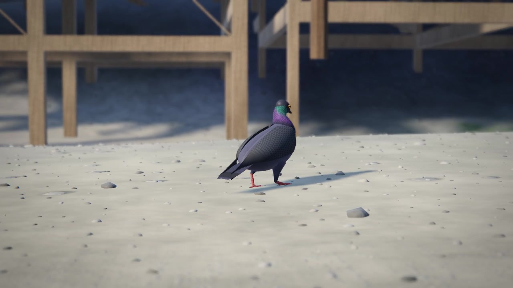
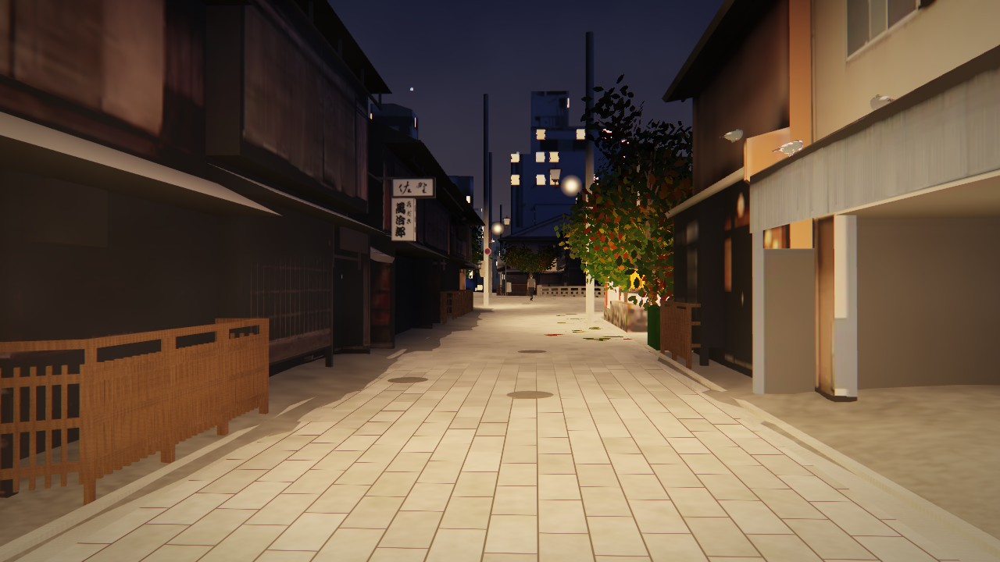
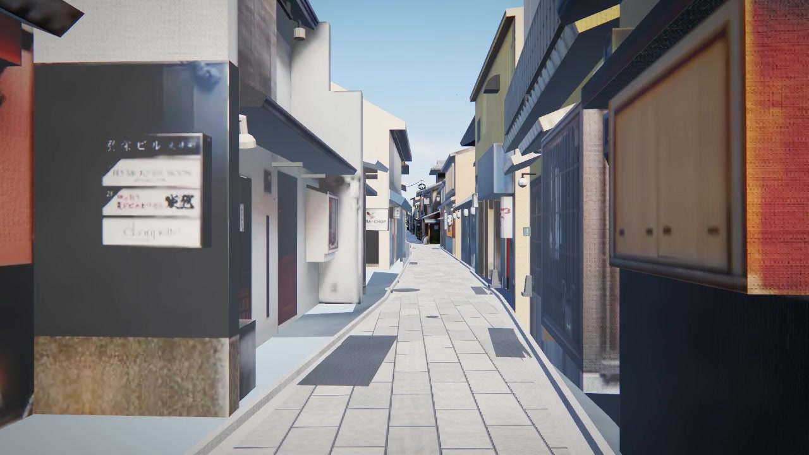
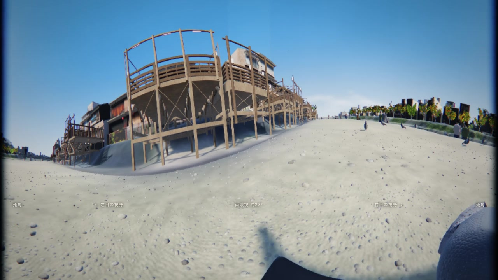
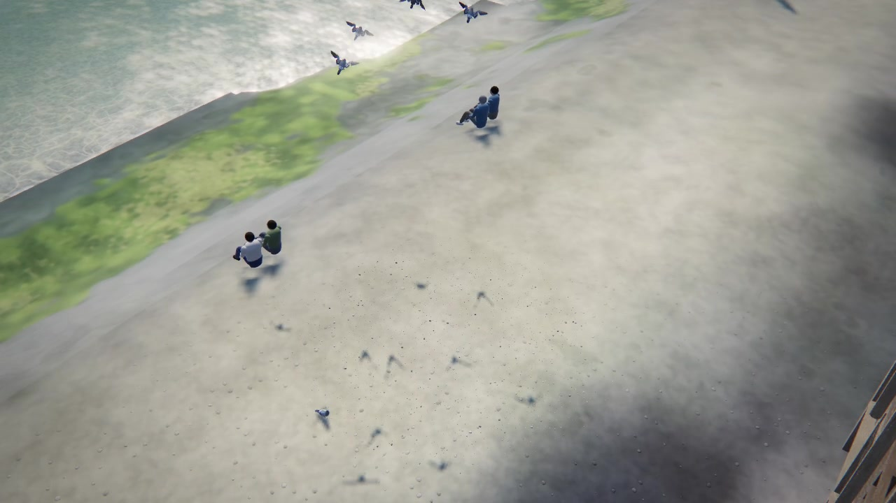
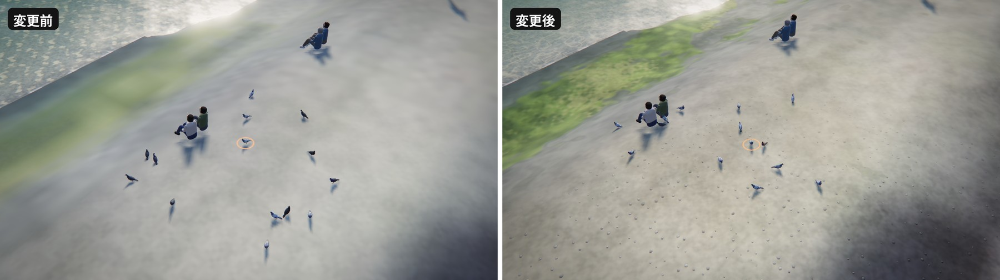
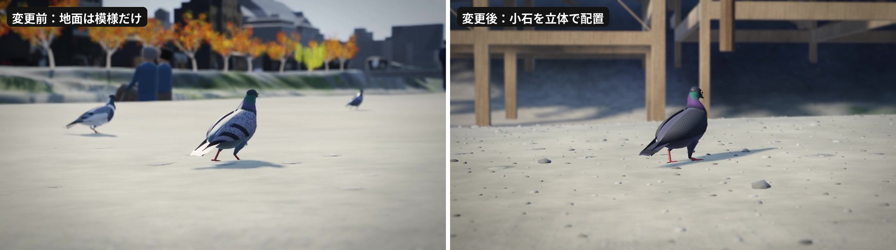
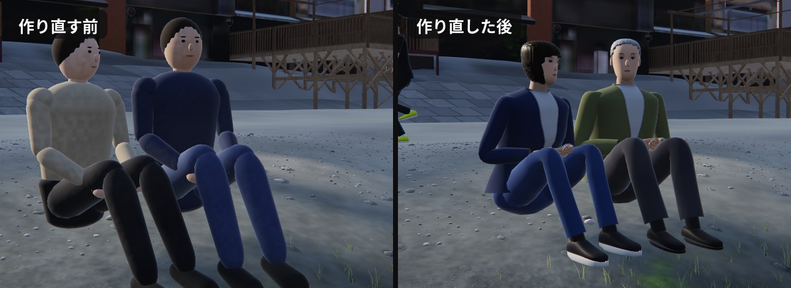
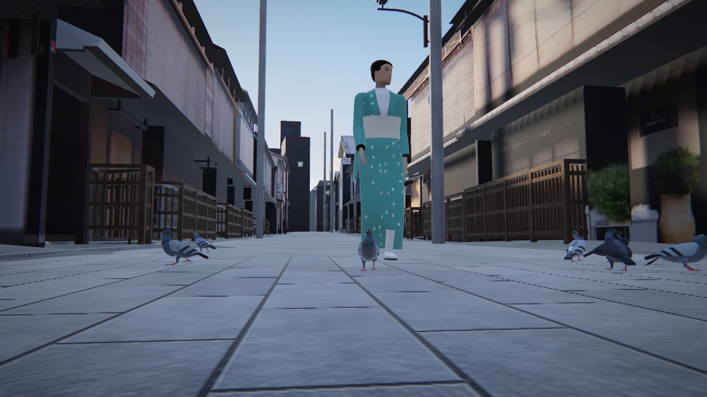
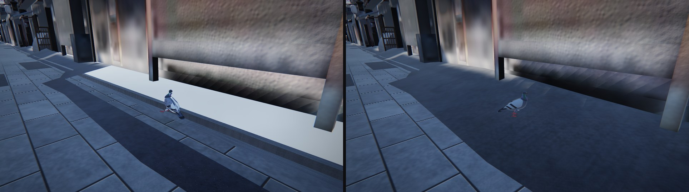

# ハトの目で京都を歩く — PLATEAU の3D都市モデルを AI にブラウザ作品へ仕立てさせた記録

2026-11-13 · kai-kou

## 何を作ったか

京都の先斗町・鴨川・祇園白川を、ブラウザの中でドバトとして歩いて飛べる作品「鳩の目、京都。」を作りました。街は国土交通省の3D都市モデル PLATEAU（京都市・2025年度版）の LOD3 建築物から再構成したもので、スマートフォンのブラウザでも動きます。

鴨川西岸、納涼床の下を歩くドバト。地面の小石は 1 個ずつ立体で置いています。

[「鳩の目、京都。」を開く](https://claude.ai/artifact/L6dDhAnGZur167TMmp6hdM)

実装はすべて AI（Claude Fable 5.2）に任せました。最初に出した指示は次の 4 点です。

- PLATEAU で最もリアリティを出せる地域を舞台にする
- ハトの視点と、ハトを俯瞰する視点の両方を用意する
- スマートフォンでも見られるようにする
- あとは全力で、超リアルに仕上げる

途中で足したのは 2 点だけです。写真をそのまま使うかコードで描くかは要素ごとに判断すること。そして、とにかくリアリティを追求すること。

できあがったものの規模は次のとおりです。

| 項目 | 値 |
| --- | --- |
| 舞台 | 先斗町・鴨川・祇園白川の約 511 m × 399 m。周囲 1.37 km × 1.33 km は簡略表示 |
| 街のポリゴン | 約 64.6 万三角形。LOD3 建築物 138 棟、LOD2 建築物 834 棟、街路設備 985 点 |
| ハト | 最大 90 羽の群れとトビ 3 羽 |
| 視点 | ハトの目（320°）、追尾、望遠、俯瞰、シネマの 5 種 |
| 時間と天気 | 0 時から 24 時まで連続に変えられる。雨上がりの濡れた路面に切り替え可能 |
| 配信サイズ | 226 ファイル、約 54 MB |
| 依存ライブラリ | three.js r170 のみ。ビルド工程なし |

この記事は、その過程で AI が下した技術判断と、つまずいた点、検証できたこととできなかったことの記録です。

夜の祇園白川。街灯の位置は PLATEAU の都市設備データから取っています。右手の軒先ではハトが眠っています（v27）。

## なぜ京都・先斗町か

舞台は、PLATEAU の LOD3 建築物のテクスチャ密度を実測して決めました。先斗町と祇園白川の LOD3 は、壁 1 m あたりの画素数が中央値で約 86 ピクセルあり、比較した東京・虎ノ門周辺の約 17 倍でした。

ハトの目線は地面から 20 cm ほどです。路地では壁まで 1〜2 m しかないので、建物の形の細かさよりも、壁に貼られた写真の細かさが見た目を決めます。そこで形状の LOD ではなく、テクスチャの実解像度を選定基準にしました。

手順は次のとおりです。

1. PLATEAU のデータカタログ API から、LOD3 の建築物 3D Tiles を持つ市区を洗い出す。該当は 24 市区
2. そのうち 22 市区ぶん、約 11 GB の 3D Tiles を取得し、LOD3 の棟数と分布を集計する
3. 有力な候補について、三角形ごとに「テクスチャ上の面積 ÷ 実面積」を計算し、面積で重み付けした分布を出す

| 地域 | LOD3 の棟数 | テクスチャ付きの面積 | 密度の中央値（px/m） | 密度の上位 10% 点（px/m） |
| --- | --- | --- | --- | --- |
| 京都市 先斗町・祇園白川 | 138 | 88% | 85.8 | 170.9 |
| 沼津市 沼津駅から沼津港 | 473 | 74% | 25.9 | 63.9 |
| 東京都港区 虎ノ門・新橋 | 102 | 95% | 5.0 | 18.2 |

数値はそれぞれの計測範囲内の LOD3 建築物だけを対象にしたもので、市区全体の値ではありません。85.8 px/m は 1 画素が約 1.2 cm、5.0 px/m は約 20 cm に相当します。

京都を選んだ理由はあと二つあります。街灯・看板・祠といった都市設備、道路、橋梁、植生の LOD3 が同じ範囲に揃っていること。そして路地、川、花街という性格の違う景色が徒歩圏に収まっていることです。

先斗町通。壁は PLATEAU LOD3 の写真テクスチャ、石畳はコードです。

ただし LOD3 があるのは先斗町通と祇園白川に沿った細い帯だけです。舞台の残りは LOD2 の 834 棟で、こちらの密度は中央値 10.6 px/m にとどまります。

## 約 1 GB の 3D Tiles を 54 MB にする

PLATEAU の 3D Tiles はそのままブラウザに流さず、Node.js の変換パイプラインで実行時専用のデータに作り直しました。入力は京都市の 8 データセット約 1 GB、出力は 226 ファイル約 54 MB です。

入力の内訳は、中京区・東山区・下京区の建築物（LOD3 まで）と、京都市全域の都市設備・道路・橋梁・植生（単独木と植被）です。地面には国土地理院の標高タイルと写真タイルを使いました。

パイプラインは 6 段です。

1. 抽出。3D Tiles（b3dm、Draco 圧縮の glTF）を読み、地心座標から鴨川上の 1 点を原点とするメートル単位の局所座標へ変換する
2. 地形と地面写真。標高タイルと写真タイルを同じ局所座標に再投影する
3. 高さラスタ。建物と設備の上面高さを 25 cm 格子に焼く。隣の建物に隠れて見えない壁の判定と、ハトが歩ける場所の判定に使う
4. テクスチャの詰め直し。元のアトラスを場所ごとに 101 枚の 2048 px アトラスへ詰め直す。見えない壁と屋根は密度を 1/4 に落とし、上限は 128 px/m。4 段階の WebP にする
5. 地面モデル。水面のマスク、50 cm 格子の歩行用グリッド、接地影用の遮蔽グリッドを作る
6. 書き出し。頂点座標と UV を 16 bit、法線を 8 bit に量子化し、頂点ごとの環境遮蔽を焼き込んで deflate で固める

段 5 には標高の基準合わせが含まれます。PLATEAU の 3D Tiles は楕円体高、地理院タイルは標高なので、そのまま重ねると建物が宙に浮きます。LOD3 の道路面と地形の差を取って中央値 37.36 m を求め、これを差し引きました。

実行時のテクスチャは距離に応じて 4 段階を出し入れします。

| 段階 | サイズ | 読み込むタイミング |
| --- | --- | --- |
| 最小 | 1.2 MB | 起動時に全アトラスぶんを一括 |
| 中 | 3.2 MB | 起動直後に背景で一括 |
| 高 | 6.6 MB（101 枚） | 近づいたアトラスだけ |
| 最高 | 17.3 MB（101 枚） | PC 向け設定で、24 m 以内に近づいたアトラスだけ |

スマートフォン向けの設定では最高段階を読み込みません。起動時に必要なのはメッシュと最小段階のテクスチャなど約 21 MB で、残りは背景で追いかけます。

## ハトの目をどう描いたか

「ハトの目」視点は、左右約 320° の視野を 1 枚の画面に展開したパノラマです。人間向けの画角 60° 前後のカメラをハトの頭に付けるだけでは、ハトが見ている世界になりません。

ハトの目は頭の側面に付いていて、視野は左右合わせて約 320° とされます。両目で同時に見えるのは正面の狭い帯だけで、Martin と Young の計測（1983 年）では最大幅 27° です。真後ろの約 40° は見えません。

ハトの目の画面。中央の細い帯が両眼視野で、左右の端が死角との境目です。

描画は次の順です。

1. ハトの頭の骨の位置にカメラを置き、6 方向を撮って立方体マップにする
2. シェーダーで、画面の横位置を方位角（左 160° から右 160°）、縦位置を仰角に割り当てて立方体マップを引く
3. 視野の端は黒に落とし、正面 27° の両眼視の帯だけわずかに明るくする

カメラは頭の骨に追従します。歩くときに頭を空間に止めては前へ送る、あの首振りがそのまま画面に出ます。ついばむと視界が地面へ倒れ込みます。

画面の下中央に見える黒いくさびは、自分のくちばしです。頭と首は描かず、くちばしと体だけを残しました。Martin と Young も、くちばしが両眼視野に入り込むと報告しています。

縦持ちのスマートフォンでは、320° を 1 行に収めると細くなりすぎます。そこで上段を左目、下段を右目の 2 段に分けました。

色は人間の 3 原色のままです。ハトが感じるとされる紫外線は表現していません。

### ハトを見る側の 4 つの視点

| 視点 | 見え方 | 操作 |
| --- | --- | --- |
| 俯瞰 | 上空から群れ全体を見下ろす。選んだ 1 羽に輪が付く | タップでハトを選ぶ、地面にエサをまく |
| 望遠 | 望遠レンズと背景のぼけで 1 羽を観察する | ドラッグで回り込む |
| 追尾 | すぐ後ろから追いかける。自分で歩かせ、飛ばせるときの視点 | スティックで移動、ボタンで羽ばたき |
| シネマ | カメラが自動で切り替わる。クレーン撮影のようなカットを含む | 操作なし |

ハト自体は 2,976 頂点、15 本の骨を持つ 1 つのメッシュです。骨の姿勢をテクスチャに書き込み、最大 93 羽を 1 回の描画命令で描きます。

## 群れは台本なしで動く

ハトは 1 羽ずつが空腹と渇きを持ち、その値と時刻、周囲のハトや人の動きから次の行動を決めます。アニメーションの再生順を決めた台本はありません。

行動は次の 7 つの状態を行き来します。

| 状態 | 内容 | きっかけ |
| --- | --- | --- |
| 採餌 | 首を振って歩き、地面をついばむ | 空腹。朝と夕方は空腹の進みが日中の約 3.7 倍になる |
| 休息 | 高い場所で羽づくろい、日光浴、うたた寝 | 満腹 |
| 求愛 | オスが喉をふくらませ、おじぎと回転を繰り返す | 2.5 m 以内の地上にメスがいる |
| 水飲み・水浴び | 鴨川の水際へ飛んで飲む、浴びる | 渇き |
| 飛行 | 巡航は秒速 12.5 m、羽ばたきは毎秒 6.3〜9 回 | 場所の移動 |
| 一斉飛翔 | 驚いた 1 羽から周囲へ飛び立ちが広がる | 人が近すぎる、トビが来る、手をたたく |
| ねぐら | 街灯の届く軒先や納涼床、橋の桁、屋根の縁で朝まで動かない | 日没の前後。17:00〜17:45 に 1 羽ずつ帰る |

台本が無くても、時刻ごとの過ごし方は分かれます。群れだけを 4 つの時刻で 30 分ずつ走らせ、各行動に使われた時間の割合を数えました。

| 時刻 | 採餌 | 休息 | 飛行 | 求愛 | 水飲み・水浴び | ねぐら |
| --- | --- | --- | --- | --- | --- | --- |
| 7:30 | 88.1% | 4.2% | 5.4% | 1.9% | 0.4% | 0% |
| 12:00 | 51.2% | 41.3% | 6.0% | 1.2% | 0.3% | 0% |
| 15:30 | 88.2% | 4.6% | 5.1% | 1.9% | 0.3% | 0% |
| 22:00 | 0% | 0% | 0% | 0% | 0% | 100% |

条件は 90 羽、人とトビなしで、3 回走らせた平均です（v27 で集計し直した値）。休息には羽づくろい、日光浴、うたた寝を含みます。朝と夕方は食べることに集中し、正午は約 4 割が高い場所で休みます。飛行 1 回の長さは中央値で約 12 秒でした。

一斉飛翔は全員が同時に飛ぶのではなく、驚きの中心からの距離 1 m ごとに 0.03 秒ずつ遅れて飛び立ちます。波が群れを渡っていくように見えるのはこの遅れのためです。

手をたたいた直後。近いハトから順に飛び立ちます。

人と車も動きます。歩行者が 1.5 m 以内に来るとハトは歩いて避け、ランナーが 3 m 以内に来ると飛び立ちます。上空にはトビが 3 羽旋回していて、群れの真上を通ると採餌中のハトが一斉に飛び立ちます。

見る側ができることは 3 つです。

- エサをまく。55 m 以内の地上のハトと、110 m 以内を飛んでいるハトの多くが集まってきてついばむ。夜は眠っていて来ない
- 手をたたく。近くの群れが一斉に飛び立つ
- 1 羽を選んで自分で動かす。歩く、ついばむ、羽ばたいて飛ぶ

観察できた行動は「行動図鑑」に記録されます。全 16 種で、それぞれに短い解説が付きます。

## 写真のまま使うか、コードで描くか

判断の基準は一つです。その場所だと分かる情報は測量データと写真をそのまま使い、時間で変わるもの、近づくと解像度が足りなくなるもの、データに無いものはコードで描きました。

| 要素 | 方法 | 理由 |
| --- | --- | --- |
| LOD3 建築物の壁 | PLATEAU の写真テクスチャをそのまま | 看板や格子まで写っている。作り直すと別の街になる |
| 壁の質感 | 写真の上に細かい凹凸をコードで重ね、拡大時は輪郭を強調する | 写真の解像度を超えて近づいたときのぼけを補う |
| 地面の色 | 国土地理院の空中写真 | 道と草地の境目、河川敷の色が実際の配置どおりになる |
| 地面の砂利・石・草 | コード | 空中写真は 1 画素が約 50 cm。ハトの目線では 1 画素が画面いっぱいになる |
| 建物の足元と路地裏の地面 | コード。明るさだけ空中写真から取る | 空中写真には上の屋根が写っていて、地上から見ると屋根の色の帯になる |
| 街灯・柵・祠 | PLATEAU の都市設備モデル | 位置と形が測量されている。街灯 184 基は夜の光源にも使う |
| 石畳 | コード | 道路の LOD3 には形だけがあり、テクスチャが無い |
| 鴨川の水 | コード | 流れ、川底、反射、浅瀬の白波は時間で変わる |
| 空と太陽 | コード | 0 時から 24 時まで連続に変えるため |
| 木 | 位置と高さは PLATEAU、枝葉はコード | 81 本の位置と樹高はデータどおり。樹種はデータに無いので場所から推定した |
| 四条大橋など鴨川の橋 | コード | 取得した橋梁データの範囲に含まれていなかった |
| ハト、トビ、人、車 | コード | データに無い |
| 音 | コード | 音声ファイルは 1 つも使わず、川音から鳴き声までブラウザ上で合成する |

地面はこの使い分けが最も効いた箇所です。空中写真を拡大すると、草地と道の境目が幅 1 m のぼやけた帯になります。そこで写真の緑の強さにノイズを足してしきい値で切り、境目をぎざぎざの鋭い線として描き直しました。

砂利の粒は、1 画素が地面の何 cm に当たるかを計算し、その 3〜6 画素ぶんの大きさのノイズを常に重ねています。近づいても離れても、画面上では同じ細かさの粒が見え続けます。

俯瞰での比較。左は空中写真の拡大がそのまま見えています。

ただし模様では足りない場面があります。地面から 20 cm の高さで見ると、地面を見る角度が浅すぎて、描いた模様は横縞に潰れてしまいます。そこでハトのそばだけ、小石と草を立体として置きました。

範囲は半径 3〜4 m で、小石は約 2,600〜4,800 個です。位置と大きさは、地面に固定した格子の番号からハッシュで決めます。ハトが同じ場所に戻れば、同じ石が同じ場所にあります。草は、空中写真が緑の場所にだけ生やします。

望遠での比較。右は小石を立体として置いたものです。

人も、近づくと足りなくなったものの一つです。最初の人は、先細りの筒 14 本と球 12 個をつないだ人形でした。俯瞰では気になりませんが、ハトの目線では、前を通る人の脚と靴が画面の大半を占めます。

そこで作り方を変えました。体・服・靴・髪を、輪切りの断面を積み上げた曲面として作り、13 本の骨で曲げています。体格、服の種類と色、髪型は 1 人ずつ乱数で決めます。歩き方は、かかとから着地してつま先で蹴り出す足の運びを計算しています。祇園と先斗町には着物の人もいます。

同じ場所、同じカメラでの比較。左が最初の人形、右が作り直した人です。

祇園・新橋通。エサに集まっていたハトが、歩いてきた人を避けて左右に分かれたところです。地面から 17 cm の高さで撮っています。

川端通と四条通、四条大橋の路面もコードで描きました。空中写真には走っている車と街路樹が写り込んでいて、地上から見るとにじんだ帯になります。車線の位置を決めて、アスファルトと白線を描いています。

## つまずいた 13 か所

途中で起きた不具合と事前に避けた落とし穴のうち、同じことを試す人が踏みそうなものを 13 件挙げます。

| 症状 | 原因 | 対処 |
| --- | --- | --- |
| 地面が薄紫になり、小石が白い米粒に見えた | 取得した PLATEAU オルソ画像のタイルが、この範囲では緑と青が同じ値だった | 地面の写真を国土地理院のシームレス空中写真に切り替えた |
| 公開先がバイナリファイルを受け付けなかった | ホストが Web で一般的な拡張子だけを配信する仕様で、.bin は拒否された | データを base64 の .txt にしてページ内で復号する。サイズは 33% 増える |
| 路地で地面が盛り上がり、石畳を突き破った | 1 m メッシュの地形は、建物に挟まれた狭い隙間で高さが乱れる | LOD3 道路の近くでは、地形を道路の測量高さに合わせる |
| そのまま重ねると建物が地面から約 37 m 浮く | PLATEAU は楕円体高、地理院タイルは標高で、高さの基準が違う | LOD3 道路面と地形の差の中央値を求めて差し引く |
| 水面反射を有効にすると WebGL がフィードバックループを報告した | 反射用テクスチャへ描いている最中に、同じテクスチャを読むマテリアルが画面内にあった | 反射を描く間だけ参照を外す |
| 夜にだけシェーダーエラーが出た | ハトの影用の深度テクスチャが、太陽が出るまで一度も描かれず未初期化だった | 太陽の有無に関係なく、最初に一度描く |
| smoothstep に下限と上限を逆順で渡していた | GLSL では下限が上限より大きいと結果が未定義になる | どちらの順でも同じ結果になる自前の関数に置き換えた |
| 群れが落ち着かず、常に 3〜6 割が飛んでいた | 空腹と渇きの進みが速すぎ、移動の判断が頻繁すぎた | 群れだけを早回しで走らせ、行動ごとの時間割合を見ながら係数を調整した |
| ハトの視野を 330°、両眼視を 24° と書いていた | AI の記憶違い | 文献を確認し、320° と 27° に直した |
| 河川敷の石が、近くで見るとコインに見えた | 平らな地面に模様として描いた石は、低い視点では立体に見えない | 模様の石は離れたときだけ描き、ハトのそばには立体の小石を置いた |
| 歩く人が建物の中を通り抜け、川の上を歩いていた | 歩く道筋を 2 点を結ぶ直線で決めていた。祇園の新橋通は斜めに走り、鴨川の遊歩道は北へ行くほど西へ寄る | 歩行用グリッドから道路と河川敷の平らな帯をたどり、その中心を道筋にした。人を作り直して近くで見るまで気づかなかった |
| 路地で、壁の足元が白く光る帯になっていた | 建物の下の地形を省いていたが、その範囲には軒下や奥まった入口も含まれていた。そこでは地面が抜けて、空の色が見えていた | 地形を省くのは、建物の内側 6 m より奥だけにした。建物の影も表裏両面で落とし、地面まで届かない壁の下から日が漏れるのを止めた。地面から 20 cm の高さで壁際を撮るまで気づかなかった |
| 胡麻模様のハトの羽が、近くで見ると砂をまいたようにざらついていた | 1 羽ごとの色と乱数の種を、頂点から画素へ補間して渡していた。3 頂点が同じ値でも、遠近補正つきの補間では画素ごとに末尾のビットが揺れる。その値をハッシュ関数に入れていたので、揺れが模様のざらつきになった | 1 羽ごとの値は、補間しない指定（flat）で渡すようにした。羽も、1 枚ずつ重なりを計算する描き方に変えた。カメラを約 50 cm まで寄せて撮るまで気づかなかった |

2 件目は Claude のアーティファクトとして公開する場合に限った制約です。自前のサーバーや静的ホスティングに置くなら、バイナリのまま配信できます。

12 件目の修正前と修正後。左は壁の足元の地面が抜けて、空の色が見えています。

## スマートフォン対応と、AI が自分で確かめた範囲

画質は端末に合わせて 3 段階を自動で選びます。描画が間に合わないときは、実行中に内部解像度をさらに下げます。

| 設定 | 対象 | 内部解像度 | MSAA | 影の解像度 | 水面反射 | 背景のぼけ | ハト |
| --- | --- | --- | --- | --- | --- | --- | --- |
| 高 | PC | 100% | 4 倍 | 2048 | あり | あり | 90 羽 |
| 中 | メモリ 6 GB 以上などのスマートフォン | 75% | 2 倍 | 1536 | なし | あり | 70 羽 |
| 低 | それ以外のスマートフォン | 60% | なし | 1024 | なし | なし | 46 羽 |

小石と草の立体表示は高と中だけで、低では省きます。最低解像度まで下げても遅い端末では、背景のぼけと小石・草をその場で省き、解像度をもう一段下げます。それでも遅ければ、水面の映り込みと輪郭の補正（MSAA）も外します。スマートフォンではメモリ不足などで描画が途中で止まることがあります。その場合は画質を 1 段下げて自動で再開します。

操作は縦持ちと横持ちの両方に合わせてあります。左下のスティックで歩かせ、右側のボタンで羽ばたき、ついばみ、エサまき、手たたきを行います。

AI には実機がありません。そこで、手元で動かせるものを組み合わせて次の検証を行いました。

| 確かめたこと | 方法 | 結果 |
| --- | --- | --- |
| 描画が壊れていないか | ヘッドレス Chrome（ソフトウェア描画）で 3 段階と 5 視点を撮影し、目視 | エラーなし |
| スマートフォンの画面に収まるか | 縦 390×844 と横向きをタッチ操作つきでエミュレート | ボタンの重なりなし |
| Safari 系と Firefox で動くか | Playwright の WebKit 26.6 と Firefox（ソフトウェア描画）で起動し、全視点の切り替え、エサ、手たたき、手動飛行、夜への切り替えを自動操作 | エラーなし |
| 公開先の制約で動くか | 厳しい CSP、入れ子のパス、サンドボックス化した別オリジンの iframe を再現し、Chromium と WebKit で実行 | 起動し、クリック後に音声が再生状態になる |
| ファイルの欠け | 全ファイルの取得を記録 | 404 なし |
| 音量と音の高さ | 11 種の音をオフラインで合成し、波形のピークとスペクトルを計算 | 鳴き声の基音は 370〜400 Hz、トビの声は 1.9〜2.3 kHz。音割れなし |
| 群れの振る舞い | 群れだけを 30 分ぶんずつ走らせて集計 | 前の章の表のとおり |
| 描画が止まったあと再開できるか | ヘッドレス Chrome で描画コンテキストを強制的に失わせる操作を 3 回 | 高→中→低と下げて自動で再開。3 回目は自動再開をやめ、案内とボタンを出す |
| タップとボタンが効くか | ヘッドレス Chrome に実際のマウスとポインターの入力を送り、読み込み表示、俯瞰と「ハトの目」でのタップ、音のボタン、時刻の切り替え、空中での「ついばむ」など 18 項目を自動で確認（v26 で追加） | すべて通過 |
| 音が出ているか | 出力の手前で波形を取り、音量を計測（v26 で追加） | −21〜−29 dB の信号が出ている。耳で聴いた確認ではない |

確かめられなかったこともあります。

- 実機のフレームレート。ソフトウェア描画の速度からは推定できない
- 耳で聴いた音の印象。数値が妥当でも、自然に聞こえるかは別の問題
- 実際の GPU とドライバーごとの差。確認できたのは Chromium、WebKit、Firefox のソフトウェア描画まで

この 3 点は、人間が手元の端末で確かめる項目として残りました。

実機での確認用に、作品の「i」ボタンの最下段に動作状況を出すようにしました。その端末で選ばれた画質、1 コマの平均時間、内部解像度、起動にかかった時間、音の状態と出力レベル、GPU 名が読めます。

## 公開後に届いた指摘で直したこと

公開後、実際に遊んだ人から報告が届きました。不具合が 4 件、改善の提案が 5 件です。前の章で「確かめられなかった」と書いた範囲と、そのまま重なっていました。v26 と v27 で次のように直しました。

| 指摘 | 原因 | 対処 |
| --- | --- | --- |
| 夜に切り替えると全羽が飛び立ち、朝に戻しても約 5 分降りてこない | 時刻を手で変えたときも、時間が流れたときと同じように全羽を「ねぐらへ飛ぶ」へ切り替えていた。降りる条件も厳しく、目的地の近くを回り続けるハトがいた | 時刻を手で変えたときは、その時刻にいるはずの場所へ直接置く。時間を流しているときは 17:00〜17:45 に 1 羽ずつ帰る。目的地の近くに 4 秒いたら降りる |
| 夜、歩行者の頭上にピンクの光る箱が見える | 壁の写真の暖色を明かりとみなして光らせる処理が、看板や壁の広い面にも効いていた | その処理を 3 割に抑え、PLATEAU の照明 184 基の灯具の位置に明かりを置いた |
| 夜、舗道に黒い斑点が見える | 落ち葉が街灯の光を受けていなかった。先斗町の暗い四角は PLATEAU のデータにある鉄蓋で、これは元のまま | 葉に街灯の光を当てた。鉄蓋は色を明るくし、滑り止めの模様を描いた |
| 「音」ボタンを押しても音を確認できない | 再現できなかった。計測では信号が出ていた。ただ、ボタンの色が「入」か「切」かは見ただけでは分からなかった | 表示を「音 入／切」にし、切り替えたときに文字でも知らせる。出力の計測を検査に加えた |
| 地面やハトをタップしても変化がない | 「ハトの目」ではタップを受け付けていなかった。ほかの視点でも、指が数ピクセル動くと無視していた | どの視点でもタップでハトを選び、地面にエサをまける。タップした場所に輪を出し、結果を文字で知らせる |
| 読み込みが長く、途中で止まって見える | 進み具合の表示はデータの取得だけを表していた。そのあとの組み立てとシェーダーのコンパイルは無表示だった | 取得した量を MB で、組み立てを段階の名前で出す。シェーダーは最初の 1 コマの前にコンパイルする。紹介ページを読んでいる間に、データを先に取得する |
| 飛んでいるハトを下から見ると、胴が風船、翼が薄い板に見える | 翼は上から見た形だけを作り込んでいた。胴は地上の姿のまま飛んでいた | 風切羽の幅を広げて重ね、翼の下面を淡い色にした。飛行中は胴を細くし、脚を腹に収める |
| 俯瞰では建物が無地の灰色の箱に見える | LOD3 の範囲の外にある LOD2 の建物は、写真を使わず単色で塗っていた | 屋根の色を空中写真から取り、瓦の筋と壁の窓を描いた |
| 飛んでいる群れにエサをまいても降りてこない | エサに反応するのは、地上にいるハトだけだった | 110 m 以内を飛んでいるハトも降りてくる |
| 空中で「ついばむ」を押すと滑空する | 空中では無効な操作に、説明がなかった | 空中ではボタンを薄くし、押したときは「空中ではついばめない」と出す |

夜の見え方の指摘は原因が 2 つあったので、2 行に分けました。報告にあった「構築中 22%」という表示は作品の中には見つからず、どの画面を指すのかは分かりませんでした。

報告には、内部解像度が最低の 42% まで下がって約 20 fps だった、という計測も含まれていました。端末の種類は分かっておらず、こちらで確かめた値ではありません。描画量を数えると、望遠の視点で 1 コマ約 560 万三角形、「ハトの目」では 6 方向を描くので約 1,300 万三角形でした。非力な GPU には重い構成です。今回足したのは、水面の映り込みと輪郭の補正も外す段階までです。遠くのハトを粗い形に切り替える仕組みは入れていません。

この 10 件のうち、検証スクリプトが事前に見つけていたものは 1 件もありません。スクリプトが見ていたのは「エラーが出ないこと」と「ボタンを押すと内部の状態が変わること」でした。「夜にハトが飛び回るのはおかしい」「下から見た翼が板に見える」は、見る人がいて初めて出てくる指摘です。対応のあと、タップは実際の入力イベントで、音は出力の計測で確かめる項目に加えました。見た目と挙動のもっともらしさは、いまも人が見るまで分かりません。

直している途中で、指摘とは別の不具合も 1 件見つかりました。水飲みと水浴びの場所になる水際が、78 か所あるはずなのに 11 か所しか候補になっていませんでした。水深が 0.06 m 未満かどうかで判定していて、ちょうど 6 cm の水際では、小数の丸め誤差で結果が分かれていたためです。候補から 3 割を選ぶので、約 2% の確率で水場が 1 つもない回ができ、その回は水飲みと水浴びが一度も起きません。センチメートルの整数で比べるように直しました（v27）。群れの時間割合を集計し直したとき、3 回のうち 1 回で水飲みが 0% だったことで気づきました。

## できていないこと

現実と違う点と、作り込めていない点は次の 9 つです。

- 季節は 10 月中旬に固定している。PLATEAU のモデルに鴨川の納涼床が写っているので、床が出ている期間（5 月 1 日から 10 月 15 日）の最終週に合わせた。最初は紅葉の 11 月にしていて、床と季節が矛盾していた。桜や紅葉の盛りは再現できない
- 人は体・服・靴・髪を 1 人ずつコードで作り、13 本の骨で動かしている。それでも顔と指は簡略で、服のしわは模様にすぎない。2〜3 m まで近づくと作り物だと分かる
- LOD3 があるのは先斗町通と祇園白川沿いだけ。少し離れると LOD2 の箱形の建物になる。屋根の色と窓は付けたが、形は箱のままである
- LOD3 の道路はすべて石畳として描いている。車線として記録された区間も石畳になるので、実際の舗装とは違う可能性がある。川端通と四条通は LOD3 の範囲外で、アスファルトと車線をコードで描いた。車線の本数と位置は推定である
- 木の種類、鴨川の橋の細部、人と車の量は推定と演出である
- ハトの数と行動の頻度は、観察しやすいように調整してある
- 遠くのハトも近くのハトと同じ細かさで描いている。重いときに下げられるのは、解像度、ぼけ、小石と草、影の更新頻度、映り込み、輪郭の補正までで、形の細かさは変わらない
- LOD2 の建物の屋根の色は空中写真から取っている。写真は真上からの正射ではないので、高い建物では位置が少しずれる
- 夜、ハトが眠る場所は街灯の届く軒先や納涼床に寄せてある。実際のねぐらの分布を調べたものではない

ハトの行動は実際のドバトの生態をもとにしていますが、観察記録と照合したものではありません。生態の資料としてではなく、街とハトを眺める作品として見てください。

## データと出典

本作品は次のデータを加工して作成したもので、国土交通省、国土地理院、京都市が内容を保証するものではありません。

| 用途 | データ | 出典 |
| --- | --- | --- |
| 建物、都市設備、道路、橋梁、植生 | 3D都市モデル（京都市、2025 年度）。建築物 LOD3・LOD2、その他は LOD3 | [国土交通省 Project PLATEAU](https://www.mlit.go.jp/plateau/)。配布は [G空間情報センター](https://www.geospatial.jp/ckan/dataset/plateau) |
| 地形、水面の範囲 | 地理院タイルの標高タイル（DEM1A、DEM5A、DEM10B）を加工して作成 | [国土地理院コンテンツ利用規約](https://www.gsi.go.jp/kikakuchousei/kikakuchousei40182.html) |
| 地面の色 | 地理院タイルのシームレス空中写真を加工して作成。遠景の地表の色は地理院タイル（シームレス空中写真、ズームレベル 12）を加工して作成。データソース：Landsat8画像（GSI,TSIC,GEO Grid/AIST）, Landsat8画像（courtesy of the U.S. Geological Survey）, 海底地形（GEBCO） | 同上 |
| ハトの両眼視野の幅 | Martin, G. R. & Young, S. R. (1983) The retinal binocular field of the pigeon. Vision Research 23(9), 911–915 | [PubMed 6636551](https://pubmed.ncbi.nlm.nih.gov/6636551/) |
| 納涼床の期間 | 鴨川納涼床、2026 年 5 月 1 日から 10 月 15 日 | [京都観光Navi](https://ja.kyoto.travel/event/single.php?event_id=4902) |
| 描画ライブラリ | three.js r170（MIT License） | [three.js](https://threejs.org/) |

PLATEAU のオープンデータは、出典を表記すれば複製、加工、商用利用ができます（[国土交通省の発表資料](https://www.mlit.go.jp/common/001418346.pdf)）。実装と検証は Claude Fable 5.2 が行いました。

コード、データ変換パイプライン、撮影と検証のスクリプトは [GitHub の kai-kou/hato-no-me-kyoto](https://github.com/kai-kou/hato-no-me-kyoto) で公開しています。
