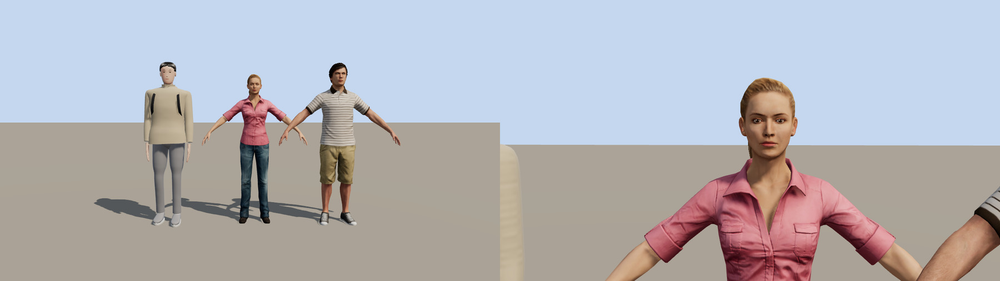
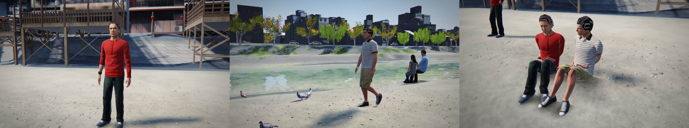

# 人の表現: 調査、限界の線引き、入れたもの

2026-11-14。人のリアリティを上げるために、外観と、動き・見せ方の 2 つの調査を並行して行い（調査担当 2 名）、その結果からこの作品で効くものを選んで実装した。確認はソフトウェア描画の画面写真で、実機では見ていない。

- 調査の全文: [people/research-appearance.md](people/research-appearance.md)、[people/research-motion-staging.md](people/research-motion-staging.md)。どちらも、出典に書かれていたこと・そこからの推論・未確認の記憶を区別して書いてある。
- 人だけを並べて見る確認ページ: `tools/dev/_people.html`（作業用の app ディレクトリに置いて `python3 tools/people.py <出力> "<クエリ>"`）。街を読み込まないので 1 枚 10 秒ほどで撮れる。

## 限界として諦めたこと

顔と手を写真のように見せることは、コードだけで作る形とテクスチャなしの条件では届かない。調査でも、顔・指・まばたき・遠くの呼吸は「やらないほうがよい」に入った。理由は 2 つある。

- 3 m より遠いと、まばたきや呼吸の動きは 1 ピクセルに満たない。
- 不気味さの原因として実証の支持が強いのは「部位ごとのリアルさの不一致」である（Kätsyri ほか 2015 のレビュー）。顔だけを描き込むと、ほかの部位との差が広がってかえって人形に見える。

そこで方針を変えた。顔は描き込みを足さず、むしろ目の細部を距離に応じて消して全体の水準をそろえる。手間は、ハトの目の高さから最初に見える足元と、光の当たり方、歩き方に回す。

## v37 で入れたもの

| 変更 | 内容 | 根拠 |
|---|---|---|
| 足元の接地 | 靴の下と、座っている人の下に、やわらかい暗がりを置く。足が上がると広く薄くなる | 視点が地上 20 cm で、靴と地面の境目が最初に見える。太陽の影だけでは足が浮いて見える |
| 目の描き込みを距離で消す | 白目を暗くし、ハイライトとまつ毛は近いときだけ出す | 目だけが周囲より鮮明だと人形に見える（リアルさの不一致） |
| 肌 | 明暗の境目を越えて光が回り込み、回り込んだ光は赤みを帯びる | 皮下散乱の近似（GPU Gems 16 章のラップ照明、Penner 2011） |
| 髪 | 毛の流れに沿った 2 本のハイライト（白と、髪色の広いもの）をずらして重ねる | Scheuermann 2004 |
| 布 | 影への落ち方をやわらかくし、浅い角度で繊維の光沢を足す | 「Charlie」分布（Estevez & Kulla 2017、Filament の式） |
| 肩 | 胴の上端を袖の上までかぶせ、肩と腕が別の部品に見えないようにした | 画面写真での確認。球が胴の横に付いたように見えていた |
| 歩調 | 1 歩の時間を速さから決める（歩調は速さの約 0.42 乗、1.48 m/s で毎分 119.5 歩）。遅い人は歩数も歩幅も減り、全員が同じリズムにならない | 日本人成人の歩行の測定値 |

比較: [img/people_v37_closeup.jpg](img/people_v37_closeup.jpg)（寄り）、[img/people_v37_lineup.jpg](img/people_v37_lineup.jpg)（8 人の並び）、[img/people_v37_feet.jpg](img/people_v37_feet.jpg)（ハトの高さから見た足元）

係数（回り込みの幅 0.30、赤みの色、光沢の強さ、暗がりの大きさと濃さ）は見た目で決めた値である。

## 調べて、すでに合っていたもの

- 足の接地: 立脚中の足は地面に対して止まっている（歩幅を速さと 1 歩の時間から決めているため滑らない）。かかとから着いて、つま先で蹴る。
- 体の寸法: 身長、頭身、肩幅、腰幅、足の長さは AIST の実測（1991〜92 年、青年）とおおむね合っている。靴の長さは身長の約 16%。
- ジョギング: 接地時間約 270 ms、毎分約 164 歩で、文献の範囲に入る。

## 次に効く順（未実装）

調査の上位から、まだ入れていないものを並べる。

1. 足音を接地に合わせて鳴らす（路面と靴で音を変える）。この環境では耳で確かめられない。
2. 立っている人・座っている人の、ゆっくりした体重移動と座り直し（数秒かけて、まれに）。今は完全に止まっている。
3. 2 人連れ・3 人連れで横に並んで歩く（歩行者の 55〜70% はグループ）。今は全員が 1 人で歩いている。
4. 靴の作り込み（ミッドソールの帯、つま先の反り、靴底の溝）。
5. 鴨川の座る人の間隔を実態に寄せる（等間隔になるのは橋の近くだけ、という調査がある）。
6. ハトが人から歩いて離れ始める距離を約 5 m にする（都市のドバトの測定）。

## 見せ方について

調査では、人を「形の細かさ」より先に「影と映り込み」で見せること、顔を画面の中心・ピントの合う位置に置かないことが挙がった。この作品の視点はもともとそうなっている。ハトの目では人は膝から下しか大きく映らず、望遠ではピントがハトに合って人はぼける。人に近寄って正面から見られるのは自由に回り込める視点だけで、そこが弱点として残る。

---

# ブラウザで、家庭用ゲーム機なみの人は出せるか（2026-11-14 の検証）

**出せる。ただし「コードだけで作る」をやめて、作り込まれた人のデータ（形・テクスチャ・動き）を読み込む場合に限る。** 限界を決めているのはブラウザではなく、素材である。

## 実際に試したこと

公開されているゲーム用の人体データ（Microsoft Rocketbox、MIT ライセンス、115 体）から男女 1 体ずつを取り、この作品と同じ three.js r170（WebGL2）で、同じ照明の下に手続き生成の人と並べた。

| | 手続き生成（今の作品） | 読み込んだ人体データ |
|---|---|---|
| 三角形 | 約 10,300 | 7,440（男）、8,732（女） |
| 骨 | 13 本 | 81 本（指と顔を含む） |
| テクスチャ | なし（頂点色とシェーダ） | 色・法線・光沢、各 2048 px |
| データ量 | 0（起動時に生成） | 形 0.5〜0.6 MB ＋ テクスチャ約 2 MB（WebP に変換。1024 px なら約 0.5 MB） |
| 読み込み | 生成に数十 ms | 解析に 1〜2 秒（この環境、FBX のまま読んだ場合） |

三角形はむしろ少ない。見た目の差は、ほぼすべてテクスチャ（顔、布のしわ、縫い目、靴）と、人が作った形から来ている。これは PlayStation 3〜4 世代の群衆・脇役の水準にあたる。

確認したのは静止した T ポーズの 2 体だけで、歩行などの動きは付けていない。この作品の描画系（影、遮蔽、被写界深度）にも組み込んでいない。実機では見ていない。

## どこまで行けるか

| 水準 | ブラウザで | 条件 |
|---|---|---|
| PS3〜PS4 世代の脇役・群衆 | できる（上の検証） | 形とテクスチャのデータを読み込む。スマートフォンでも 1 体 1 万三角形前後なら数十体は現実的 |
| PS4〜PS5 世代の主役（皮下散乱の専用パス、カード式の髪、4K テクスチャ、顔の表情） | PC の WebGPU なら 1〜数体は可能 | 1 体 5〜10 万三角形、テクスチャ数十 MB。スマートフォンと数十体の同時表示は厳しい |
| 現行の最高水準（MetaHuman、毛 1 本ずつの髪） | 端末の中では実質できない | MetaHuman は Unreal Engine の中で描く場合に限ってライセンスされており、three.js では使えない。ブラウザで見せる方法は、サーバーで描いて映像を送る方式（Pixel Streaming）になる |

出典: MetaHuman のライセンスについては Epic の FAQ と公式フォーラム（https://forums.unrealengine.com/t/will-these-metahumans-be-exportable-to-other-platforms/213621 、https://forums.unrealengine.com/t/metahuman-to-gltf/226635 ）。Rocketbox は https://github.com/microsoft/Microsoft-Rocketbox （2020 年 11 月に MIT ライセンスへ変更、2022 年に動き 417 本を追加）。

## この作品に入れる場合に変わること

- **「人もハトも街の点景もコードで生成」ではなくなる。** 応募資料や記事でそう説明しているので、入れるなら説明を直す。
- **読み込みが増える。** 10 体ぶんで約 6〜25 MB（テクスチャの解像度による）。動きのデータは元が 1 本数 MB あり、必要な数本を小さく焼き直す作業が要る。
- **京都らしさが薄れる。** Rocketbox は欧米風の普段着・仕事着が中心で、着物はない。着物の人は今の手続き生成を残すことになる。
- **描画系への組み込み。** 今の人は専用のシェーダ（濡れ、街灯、遮蔽、ハトの影）で描いている。読み込んだ人にも同じ処理を通す必要がある。
- ライセンスは MIT で、著作権表示を添えれば再配布できる。

# v38: 切り替えとして組み込んだ（2026-11-14）

既定は手続き生成のまま、`?people=asset` を付けたときだけ読み込みデータの人に替わるようにした。応募資料の説明（人もコードで生成）は既定の動作について引き続き正しい。

| 項目 | 内容 |
|---|---|
| 体数 | 12 体（女 6、男 6）。低画質では 6 体 |
| データ量 | 形・骨・動作が 1 体 0.55〜0.63 MB、テクスチャが 1 体 5 枚（1024 px、WebP）。合計 12.2 MB |
| 動作 | 歩行 2 種、立ち 2 種、スマートフォン操作、着座。四元数を 16 bit に量子化し、15〜30 コマ/秒で保持 |
| 描画 | 街と同じ材質関数（`cityMaterial`）を通すので、影、遮蔽、街灯、被写界深度は同じ処理になる |
| 置き換えた人 | 歩く人（着物と走る人を除く）、立つ人、河原に座る人 |

組み込みで分かったこと。

- **頂点ウェイトの合計は厳密に 1 にする。** ウェイトを 8 bit に量子化すると合計が 254/255 や 256/255 になる頂点が出る。スキニングはワールド座標で行うので、合計が 1/255 ずれた頂点はワールド原点に向かって 0.4 % 動く。原点付近の確認ページでは見えず、原点から 80 m 離れた河原では 0.3 m のトゲになった。読み込み時に最大のウェイトへ端数を寄せて直した。
- **地面に座る動作はライブラリにない。** 椅子に座る動作しかないため、腰を地面まで下ろし、足先を前方の地面へ、手を腿の同じ位置へ、2 関節の逆運動学で合わせた。上体は椅子のときのまま起きている。
- **歩行は収録の移動距離で進める。** 1 周期で進む距離が収録データから分かるので、歩いた距離をその距離で割って周期を進める。速度が違っても足が滑らない。

残っていること。

- 実機で見ていない。テクスチャが 1 体 5 枚あり、12 体で GPU メモリを 300 MB 前後使う計算になる。スマートフォンでは既定（手続き生成）を勧める。
- 着物の人と走る人は手続き生成のままなので、並ぶと作りの違いが見える。
- Rocketbox の服と顔立ちは欧米の街向けで、祇園の人通りとしては不自然さが残る。
- 既定にするかどうかは決めていない（「コードで生成」という説明、読み込み量、京都らしさとの引き換えになる）。
