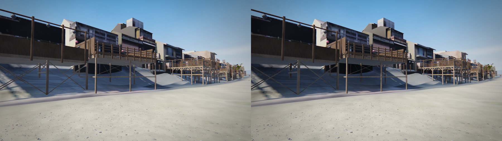

# Rust（WebAssembly）で速くできるかの検証

2026-11-14、作品 v34 で測定。結論から書く。

**Rust に置き換えても、体感できる速度の改善は見込めない。** 1 コマの時間のほとんどは GPU が三角形を描く時間で、JavaScript が使っているのは 1 コマあたり数ミリ秒。その中で Rust に移せる計算は 1 ミリ秒に満たない。読み込みも、時間の大半はブラウザ組み込みの展開処理（すでにネイティブコード）が占めている。

速くしたいなら、手を入れる場所は「描く三角形の数」と「描画命令の数」になる。

## 測定の条件

- 2 コアの仮想マシン、Chromium のソフトウェア描画（SwiftShader）、Node.js 22。
- 実機の GPU では測っていない。下の数値は「どこに時間がかかっているか」の比を見るためのもので、実機での絶対値ではない。
- 手順は `tools/prof.py`（描画中の CPU プロファイル）、`tools/bench/tickprof.py`（シミュレーション 1 ステップだけの内訳）、`tools/bench/bench.mjs`（JavaScript と Rust の比較）。Rust のソースは `tools/bench/rust/`。

## 1. 1 コマの中身

描画中のメインスレッドを 10 秒プロファイルした結果（画質「高」）。

| 視点 | 1 コマの三角形 | JavaScript と WebGL 呼び出し | 残り（GPU 側の描画待ち） |
|---|---|---|---|
| 望遠 | 約 404 万 | 1.1% | 98.9% |
| ハトの目 | 約 1,107 万 | 0.3% | 99.7% |

ソフトウェア描画では GPU の仕事も CPU で行うため、待ち時間の比率は実機より大きく出る。それでも、JavaScript 側の絶対時間（下の 2.）が小さいことは変わらない。

## 2. シミュレーション 1 ステップの内訳

描画を挟まずに 1 ステップ（1/60 秒ぶん）だけを 600 回実行した。1 ステップは平均 1.9 ms。

| 処理 | 1 ステップあたり | Rust に移せるか |
|---|---|---|
| 群れの行動と姿勢（flock.js の animate、update、think） | 約 0.36 ms | 移せる |
| 骨の書き込み（birds.js の write） | 約 0.14 ms | 移せる |
| three.js の行列・四元数の計算 | 約 0.3 ms | 一部は移せる |
| ガベージコレクション | 約 0.15 ms | 割り当てを減らせば JavaScript のままで減る |
| WebGL の呼び出し（テクスチャ更新、描画命令） | 約 0.2 ms | 移せない（ブラウザの API） |
| そのほか（人、車、UI、three.js のシーン更新） | 残り | ほぼ移せない |

Rust に移せる計算を全部足しても 1 ms 弱。60 fps の 1 コマは 16.7 ms なので、仮に 2 倍速くなっても縮むのは 0.5 ms（3%）に届かない。

## 3. 実際に Rust で書いて比べた

2 つの処理を Rust で書き、WebAssembly にして同じ入力で比べた。

**骨の計算（93 羽 × 15 本、四元数の合成と回転）**

| 実装 | 1 コマあたり |
|---|---|
| JavaScript（型付き配列） | 約 64 µs |
| Rust（WebAssembly） | 約 49 µs |

差は約 15 µs で、1 コマ（16.7 ms）の 0.1%。結果の差は最大 2.4e-7（単精度の丸め）。これは作品のコードそのものではなく、同じ種類の計算を同じ量だけ行う代表例である。

**base64 の復号（公開先の制約で、バイナリを base64 テキストで配っている）**

| ファイル | 今の JavaScript | Rust | Rust（SIMD 有効） | 参考: 展開（ブラウザ組み込み） |
|---|---|---|---|---|
| d/core.txt（15.2 MB） | 21.0 ms | 26.4 ms | 26.1 ms | 181 ms |
| d/ctx.txt（5.7 MB） | 10.1 ms | 10.5 ms | 10.2 ms | 46 ms |
| t/m.txt（3.2 MB） | 5.0 ms | 6.7 ms | 6.7 ms | — |
| d/nav.txt（3.0 MB） | 4.5 ms | 6.4 ms | 6.7 ms | 49 ms |
| t/b.txt（1.2 MB） | 1.9 ms | 2.9 ms | 2.8 ms | — |

Rust のほうが遅い。WebAssembly のメモリへ入力を写し、結果を写し戻す時間が、復号そのものの短縮を上回るため。base64 の復号は全ファイル合わせて約 43 ms で、展開（約 276 ms、ブラウザのネイティブ実装）のほうがずっと長い。

## 4. 読み込みの内訳

ローカルから読んだときの起動（画質「高」）は、準備完了まで約 2.1 秒、最初の 1 コマが出るまで約 4.2 秒。

- 取得と展開: 約 0.4 秒
- 街・地面・水の組み立て: 約 0.4 秒
- ハト、点景、人、被覆をコードで生成: 約 0.9 秒
- GPU への転送とシェーダの準備: 約 0.3 秒
- 最初の 1 コマの描画: 約 2 秒（ソフトウェア描画のため。実機では未測定）

コードで生成している部分（約 0.9 秒）は Rust で短くできる余地がある。ただし three.js のジオメトリやキャンバスのテクスチャを作る処理が多く、移すには生成コードの大半を書き直すことになる。起動時に 1 回だけの処理で、実回線では取得の待ち時間（約 21 MB）のほうが長い。

## 5. Rust を入れた場合の負担

- ビルド工程ができる（今は「ビルドなしの静的ファイル」が特徴）。
- .wasm はバイナリなので、今の公開先では base64 テキストにして配ることになる。
- 状態を JavaScript と WebAssembly のどちらが持つかを決め、毎コマ写す設計が要る。写す量が多いと 3. の base64 と同じことが起きる。

## 6. 効果が見込める順

| 対策 | 見込み | 根拠 |
|---|---|---|
| 遠いハトを粗い形にする（Issue #6） | ハトの目で最大 2 割強、望遠で 1 割弱の三角形を削減 | 1 羽 5,216 三角形 × 93 羽 × 描画回数 |
| ハトの目の 6 方向のうち、視野に入らない面の描画を省く／解像度を動的に下げる | ハトの目の描画量を面の数に比例して削減 | 6 方向で約 1,107 万三角形 |
| 描画命令をまとめる（ハトの目で約 900 回） | three.js 側の 1 コマあたり数 ms を削減 | プロファイルで three.js が 2〜5 ms |
| 毎コマの割り当てを減らす | GC の約 0.15 ms と、引っかかりの削減 | 2. の内訳 |
| 展開をワーカーに移す | 合計時間は同じだが、読み込み中の画面の固まりを減らす | 展開が約 276 ms |
| Rust（WebAssembly）への置き換え | 1 コマあたり 0.5 ms 未満 | 2. と 3. |

## 確かめていないこと

- 実機（スマートフォン、PC の GPU）での比率。GPU が速い端末では JavaScript の比率が上がるが、1 コマ数 ms という絶対値が大きく変わる理由はない。
- 羽数を数百〜数千に増やした場合。群れの近傍探索が支配的になれば、Rust の効果は変わる。今の 93 羽では当てはまらない。
- 表の「見込み」は三角形数と内訳からの見積もりで、実装して測った値ではない。

---

# 追記: リアリティのために Rust を使えるか（2026-11-14）

速度ではなく見た目のために重い計算を足せないかを調べた。読み込みが長くなることは受け入れる前提。

**結論: 使える。ただし置き場所はブラウザではなく変換パイプライン。** 光線追跡で「空がどれだけ見えるか」を焼き込む処理を Rust で書き、公開中のデータに当てたところ、納涼床や軒の下が暗くなった。計算はパイプラインで 1 回行えば済み、読み込み時間は増えない。同じ処理をブラウザ（WebAssembly）で読み込み時に行うと、この環境で約 9 分かかる見込みになった。

## 何をしたか

- 街の全三角形（中心部 64.6 万＋周辺 20.8 万）に BVH を作り、各点から余弦重みの光線を 64 本飛ばして、水平より上の方向のうち空に届く割合を求めた。
- 対象は 2 つ。建物・設置物の頂点（約 193 万点。今は頂点色のアルファに入っている遮蔽）と、地面のグリッド（0.5 m 間隔、約 88 万点。今は地面のシェーダが使う遮蔽）。
- 今の値はどちらも高さ地図からの近似（8〜12 方向の地平線スキャン）で、床の下、軒の下、張り出しを表せない。
- 試作は `tools/bench/bake/`。Rust は依存なしで、同じソースがネイティブと WebAssembly の両方になる。

## 測定

| 対象 | 光線 | ネイティブ（1 スレッド） |
|---|---|---|
| 頂点 約 193 万点 × 64 本 | 約 6,040 万本 | 77 秒 |
| 地面 約 88 万点 × 64 本 | 約 5,600 万本 | 30 秒 |

- WebAssembly（Node.js 22）では、頂点 × 4 本（約 377 万本）に BVH の構築込みで 17.3 秒、毎秒 約 22 万本。この速さで上の 2 つ（約 1.16 億本）を行うと約 530 秒。メモリは約 135 MB。
- データの増加は d/core.txt で約 0.42 MB（15.22 → 15.64 MB）。値のばらつきが増えて圧縮が効きにくくなるため。
- 2 コアの仮想マシンでの値。実機では未測定。

## 見た目の変化

納涼床の下をハトの高さから見た比較（左が今、右が焼き込み後。正午）:

- 床の下の地面と斜面が暗くなり、床が地面から浮いて見えにくくなった。
- 建物の壁の変化は小さい。LOD3 の壁は写真テクスチャで、撮影時の陰影がすでに写り込んでいるため。
- 地面の遮蔽の新旧（左が今、右が焼き込み後。白いほど空が見える）: [img/bake_ground_maps.jpg](img/bake_ground_maps.jpg)。今の版にある放射状の筋が消え、鴨川沿いの床と白川沿いの設置物の下が暗くなっている。

確認したのは正午の 2 視点だけ。夜、雨上がり、先斗町の路地、白川では見ていない。

## ブラウザで行う意味があるもの

焼き込みは時刻で変わらないのでパイプラインで足りる。ブラウザ側の WebAssembly が要るのは、実行中に変わる入力に対して重い計算をする場合で、候補は次のとおり。どれも試作していない。

| 候補 | 何が良くなるか | 懸念 |
|---|---|---|
| 音の伝わり方（路地や床の下の反響を、場所ごとに光線追跡で求める） | 路地に入ると音がこもる、川辺で開ける | 耳での確認がこの環境でできない |
| 鴨川の浅い水の流れ（浅水方程式を毎コマ解く） | 石や護岸をよける流れ、ハトの水浴びの波紋 | GPU のシェーダでも実装できる |
| 時刻に応じた照り返し（日なたの地面からの反射光を、時刻が変わるたびに再計算） | 夕方の壁に地面の色が回り込む | 1 回の再計算が数秒〜数十秒 |

## パイプラインで足せるもの（効果が見込める順）

1. 空の見え方の焼き込み（上の試作）。地面のグリッドを 0.25 m に細かくすると、柱や欄干の接地の影まで出せる（点数は 4 倍、計算は約 2 分）。
2. 照り返しの色の焼き込み（1 回反射）。日陰の壁が一様な灰色にならない。
3. ハトと人が立つ位置の明るさ（今は別の近似）を、同じ焼き込みから引く。床の下に入ったハトが暗くなる。
