## 自動計測 run-4（2026-11-15 04:06 UTC、コミット b68973a）

ランナー: macOS 15.8.2／

### macOS の Chrome

- レンダラー: `ANGLE (Apple, ANGLE Metal Renderer: Apple Paravirtual device, Unspecified Version)`
- 画面: 1440x900（倍率 1）／タッチ点: 0
- ブラウザ: `Mozilla/5.0 (Macintosh; Intel Mac OS X 10_15_7) AppleWebKit/537.36 (KHTML, like Gecko) Chrome/157.0.0.0 Safari/537.36`
- 浮動小数の描画先: あり／音の API: available／深度の比較サンプラー: {"complete": true, "lit": 1, "shadowed": 0, "ok": true}

| 条件 | 1コマ（中央値） | 最大 | 換算 | 内部解像度 | 描画の大きさ | 画質 | 軽量化 | 描画命令 | 三角形 | 起動 | エラー |
|---|---|---|---|---|---|---|---|---|---|---|---|
| ハトの目・昼 | 51.8 ms | 67.81 ms | 19 fps | 42% | 605x378 | 高 | あり | 786 | 8,290,823 | 15.565 秒 | 0 |
| 追う・昼 | 25.61 ms | 39.07 ms | 39 fps | 61% | 884x553 | 高 | なし | 405 | 5,315,494 | 8.856 秒 | 0 |
| 俯瞰・昼 | 26.24 ms | 30 ms | 38 fps | 72% | 1040x650 | 高 | なし | 238 | 4,385,928 | 4.341 秒 | 0 |
| 望遠・昼 | 23.18 ms | 28.8 ms | 43 fps | 85% | 1224x765 | 高 | なし | 316 | 4,877,136 | 3.62 秒 | 0 |
| シネマ・昼 | 31.86 ms | 130.68 ms | 31 fps | 55% | 792x495 | 高 | なし | 824 | 8,968,049 | 3.933 秒 | 0 |
| ハトの目・夜 | 51.71 ms | 58.64 ms | 19 fps | 42% | 605x378 | 高 | あり | 789 | 7,940,891 | 3.669 秒 | 0 |
| 望遠・夜 | 22.96 ms | 32.29 ms | 44 fps | 85% | 1224x765 | 高 | なし | 265 | 3,456,878 | 3.838 秒 | 0 |
| ハトの目・昼・読み込みデータの人 | 78.16 ms | 92.04 ms | 13 fps | 42% | 605x378 | 高 | あり | 2656 | 8,895,756 | 6.516 秒 | 0 |
| 望遠・昼・読み込みデータの人 | 46.97 ms | 52.74 ms | 21 fps | 42% | 605x378 | 高 | あり | 642 | 2,974,176 | 6.141 秒 | 0 |

注視中のハトの位置: **画面の外に出た時点あり**
- tele_day_asset: 2/8 回、注視中のハトが画面の外（例 画面座標 [1.03, -0.09]、距離 3.28 m、飛行中=True、視点の選び直し 0 回）

### macOS の WebKit（Safari のエンジン）

- レンダラー: `Apple GPU`
- 画面: 1440x900（倍率 1）／タッチ点: 0
- ブラウザ: `Mozilla/5.0 (Macintosh; Intel Mac OS X 10_15_7) AppleWebKit/605.1.15 (KHTML, like Gecko) Version/27.2 Safari/605.1.15`
- 浮動小数の描画先: あり／音の API: available／深度の比較サンプラー: {"complete": true, "lit": 1, "shadowed": 0, "ok": true}

| 条件 | 1コマ（中央値） | 最大 | 換算 | 内部解像度 | 描画の大きさ | 画質 | 軽量化 | 描画命令 | 三角形 | 起動 | エラー |
|---|---|---|---|---|---|---|---|---|---|---|---|
| ハトの目・昼 | 報告なし | | | | | | | | | | |
| 追う・昼 | 27.32 ms | 62.21 ms | 37 fps | 55% | 792x495 | 高 | なし | 419 | 5,080,971 | 18.114 秒 | 0 |
| 俯瞰・昼 | 25.08 ms | 31.47 ms | 40 fps | 72% | 1040x650 | 高 | なし | 244 | 4,273,374 | 8.173 秒 | 0 |
| 望遠・昼 | 23.49 ms | 42.29 ms | 43 fps | 72% | 1040x650 | 高 | なし | 231 | 4,233,804 | 8.714 秒 | 0 |
| シネマ・昼 | 25 ms | 207.8 ms | 40 fps | 61% | 884x553 | 高 | なし | 544 | 5,442,415 | 8.788 秒 | 0 |
| ハトの目・夜 | 59.47 ms | 65.56 ms | 17 fps | 42% | 605x378 | 高 | あり | 789 | 7,940,411 | 7.724 秒 | 0 |
| 望遠・夜 | 26.08 ms | 34.52 ms | 38 fps | 72% | 1040x650 | 高 | なし | 262 | 3,428,148 | 10.177 秒 | 0 |
| ハトの目・昼・読み込みデータの人 | 132.11 ms | 270 ms | 8 fps | 42% | 605x378 | 高 | あり | 2656 | 8,765,252 | 10.986 秒 | 0 |
| 望遠・昼・読み込みデータの人 | 27.03 ms | 36.68 ms | 37 fps | 55% | 792x495 | 高 | なし | 1045 | 4,952,871 | 13.044 秒 | 0 |

注視中のハトの位置: **画面の外に出た時点あり**
- over_day: 1/8 回、注視中のハトが画面の外（例 画面座標 [-0.03, 1.07]、距離 9.44 m、飛行中=True、視点の選び直し 0 回）

### iOS シミュレーターの Safari

- 機種: iPhone 17（iOS-26-2）。**シミュレーターであり実機ではありません。** 描画はホストの Mac の GPU が行います
- レンダラー: `Apple GPU`
- 画面: 402x714（倍率 3）／タッチ点: 5
- ブラウザ: `Mozilla/5.0 (iPhone; CPU iPhone OS 18_7 like Mac OS X) AppleWebKit/605.1.15 (KHTML, like Gecko) Version/26.2 Mobile/15E148 Safari/604.1`
- 浮動小数の描画先: あり／音の API: available／深度の比較サンプラー: {"complete": true, "lit": 0, "shadowed": 0, "ok": false}

| 条件 | 1コマ（中央値） | 最大 | 換算 | 内部解像度 | 描画の大きさ | 画質 | 軽量化 | 描画命令 | 三角形 | 起動 | エラー |
|---|---|---|---|---|---|---|---|---|---|---|---|
| ハトの目・昼 | 147.43 ms | 177.83 ms | 7 fps | 32% | 253x450 | 中 | あり | 895 | 8,263,520 | 23.038 秒 | 0 |
| 追う・昼 | 51.35 ms | 83.5 ms | 19 fps | 32% | 253x450 | 中 | あり | 112 | 1,803,705 | 12.888 秒 | 0 |
| 俯瞰・昼 | 60.76 ms | 91.36 ms | 16 fps | 32% | 253x450 | 中 | あり | 53 | 1,435,879 | 12.974 秒 | 0 |
| 望遠・昼 | 52.25 ms | 62.56 ms | 19 fps | 32% | 253x450 | 中 | あり | 193 | 2,288,218 | 12.422 秒 | 0 |
| シネマ・昼 | 44.83 ms | 127.13 ms | 22 fps | 32% | 253x450 | 中 | あり | 62 | 1,369,647 | 11.626 秒 | 0 |
| ハトの目・夜 | 118 ms | 211 ms | 8 fps | 32% | 253x450 | 中 | あり | 782 | 7,293,454 | 12.016 秒 | 0 |
| 望遠・夜 | 88 ms | 137.38 ms | 11 fps | 32% | 253x450 | 中 | あり | 67 | 1,181,372 | 13.356 秒 | 0 |
| ハトの目・昼・読み込みデータの人 | 151.43 ms | 212 ms | 7 fps | 32% | 253x450 | 中 | あり | 2647 | 8,127,954 | 16.581 秒 | 0 |
| 望遠・昼・読み込みデータの人 | 59.47 ms | 65.69 ms | 17 fps | 32% | 253x450 | 中 | あり | 296 | 1,559,759 | 13.422 秒 | 0 |
| 俯瞰・昼・ハトの影なし | 25.02 ms | 26.74 ms | 40 fps | 64% | 513x910 | 中 | なし | 55 | 1,087,526 | 7.55 秒 | 0 |
| 俯瞰・昼・画質高指定 | 34.97 ms | 40.72 ms | 29 fps | 47% | 282x501 | 高 | あり | 98 | 2,453,860 | 16.355 秒 | 0 |
| 俯瞰・昼・画質軽指定 | 32.31 ms | 38.48 ms | 31 fps | 33% | 265x471 | 軽 | なし | 113 | 1,230,469 | 10.695 秒 | 0 |

注視中のハトの位置: すべての計測時点で画面内

### 画面

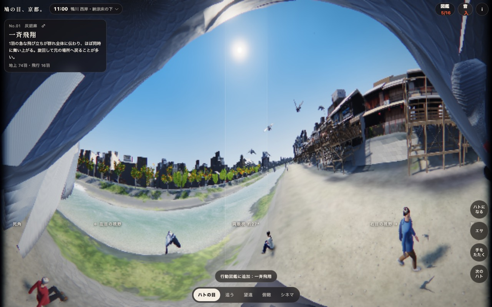
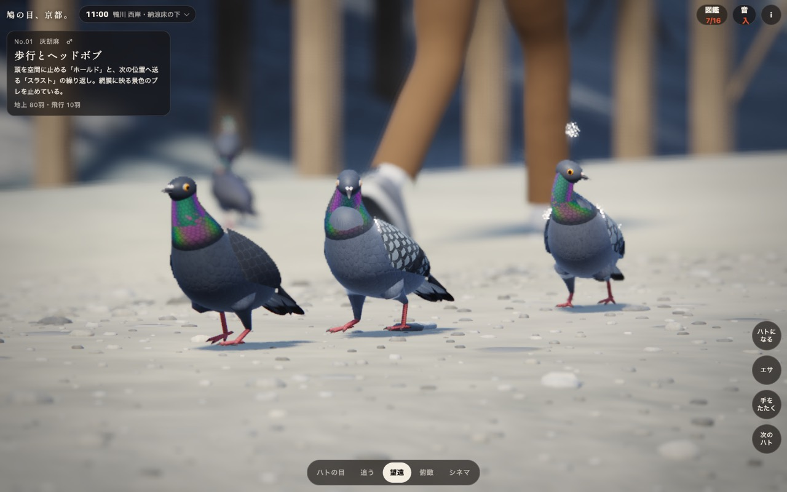
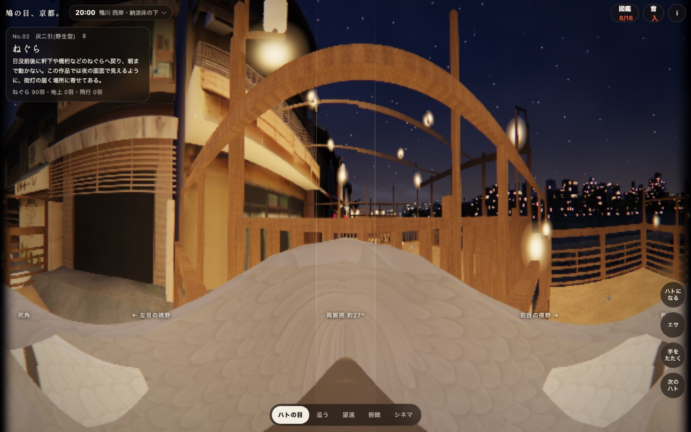
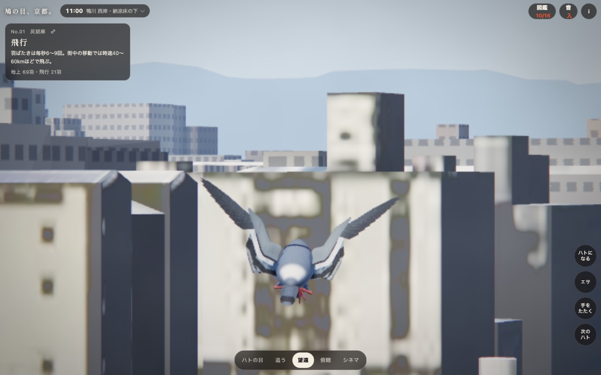

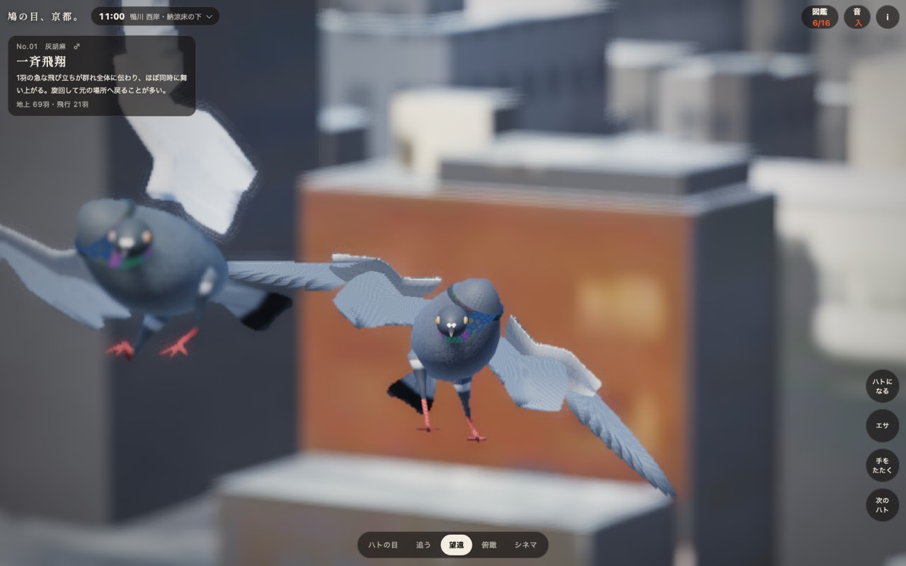
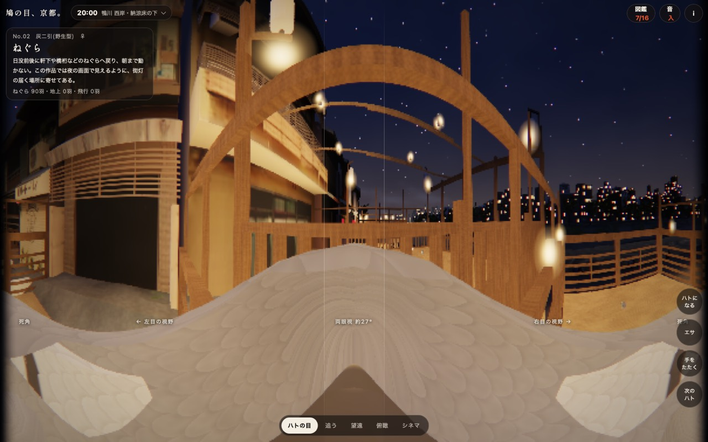
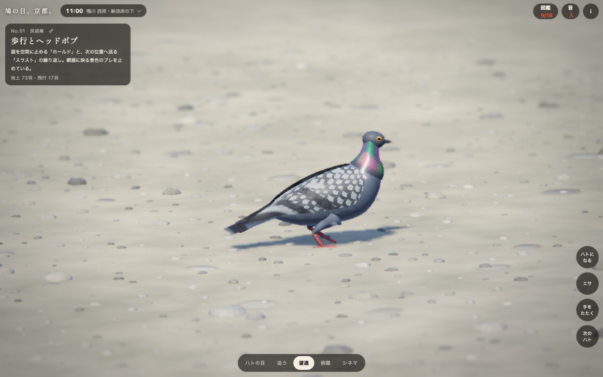

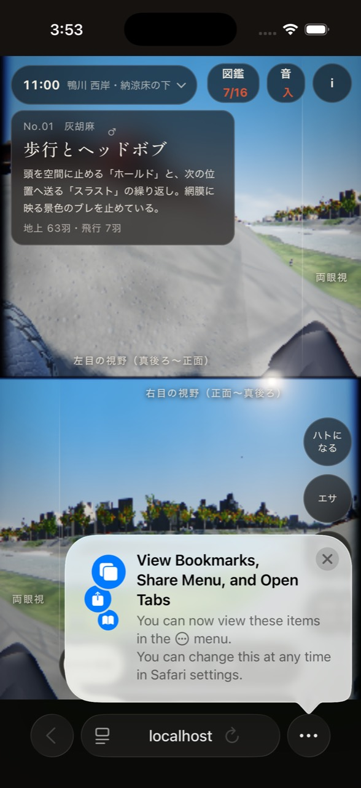
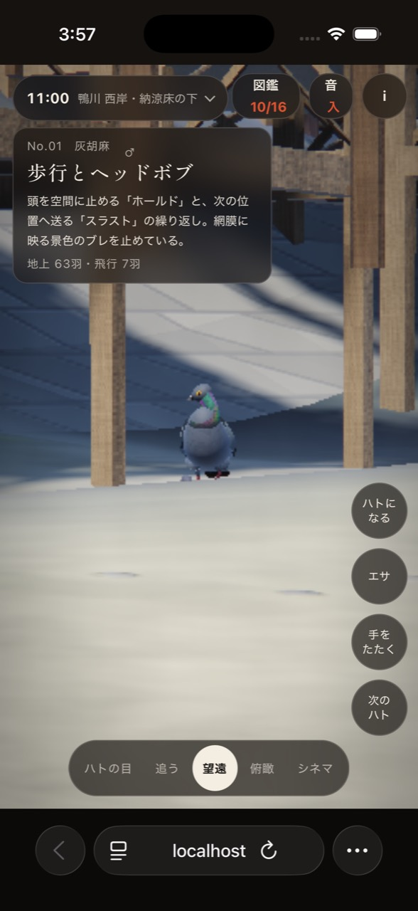
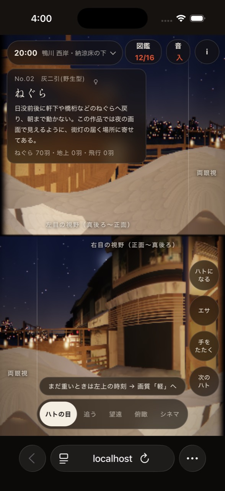
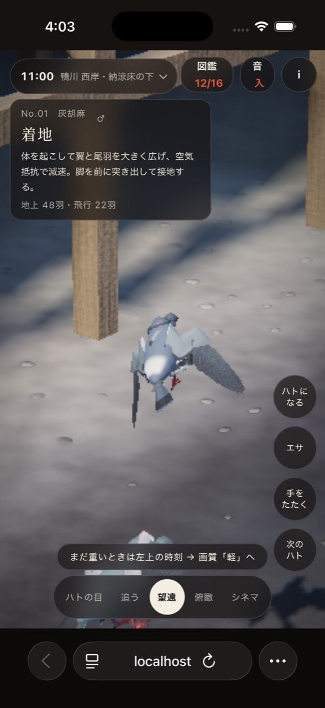

数値は作品自身が 1 秒ごとに出す 1 コマの平均です。iOS はシミュレーターで、実機ではありません。

