## 自動計測 ��2026-11-15 02:15 UTC、コミット 849aa49）

ランナー: macOS 15.8.2／

### macOS の Chrome

- レンダラー: `ANGLE (Apple, ANGLE Metal Renderer: Apple Paravirtual device, Unspecified Version)`
- 画面: 1440x900（倍率 1）／タッチ点: 0
- ブラウザ: `Mozilla/5.0 (Macintosh; Intel Mac OS X 10_15_7) AppleWebKit/537.36 (KHTML, like Gecko) Chrome/157.0.0.0 Safari/537.36`
- 浮動小数の描画先: あり／音の API: available

| 条件 | 1コマ（中央値） | 最大 | 換算 | 内部解像度 | 描画の大きさ | 画質 | 軽量化 | 描画命令 | 三角形 | 起動 | エラー |
|---|---|---|---|---|---|---|---|---|---|---|---|
| ハトの目・昼 | 44.18 ms | 55.24 ms | 23 fps | 42% | 605x378 | 高 | あり | 789 | 8,403,802 | 10.356 秒 | 0 |
| 追う・昼 | 22.25 ms | 24.79 ms | 45 fps | 85% | 1224x765 | 高 | なし | 448 | 5,539,401 | 7.089 秒 | 0 |
| 俯瞰・昼 | 21.07 ms | 22.1 ms | 47 fps | 85% | 1224x765 | 高 | なし | 258 | 4,558,062 | 4.163 秒 | 0 |
| 望遠・昼 | 18.87 ms | 19.55 ms | 53 fps | 85% | 1224x765 | 高 | なし | 318 | 5,059,233 | 2.513 秒 | 0 |
| シネマ・昼 | 73.69 ms | 145.71 ms | 14 fps | 55% | 792x495 | 高 | なし | 952 | 9,478,840 | 4.406 秒 | 0 |
| ハトの目・夜 | 27.81 ms | 28.7 ms | 36 fps | 72% | 1040x650 | 高 | なし | 942 | 9,358,505 | 3.352 秒 | 0 |
| 望遠・夜 | 18.87 ms | 21.06 ms | 53 fps | 100% | 1440x900 | 高 | なし | 262 | 3,428,228 | 4.31 秒 | 0 |
| ハトの目・昼・読み込みデータの人 | 60.66 ms | 76.92 ms | 16 fps | 42% | 605x378 | 高 | あり | 2667 | 8,955,671 | 5.54 秒 | 0 |
| 望遠・昼・読み込みデータの人 | 23.63 ms | 25 ms | 42 fps | 85% | 1224x765 | 高 | なし | 1011 | 4,987,894 | 4.375 秒 | 0 |

### macOS の WebKit（Safari のエンジン）

- レンダラー: `Apple GPU`
- 画面: 1440x900（倍率 1）／タッチ点: 0
- ブラウザ: `Mozilla/5.0 (Macintosh; Intel Mac OS X 10_15_7) AppleWebKit/605.1.15 (KHTML, like Gecko) Version/27.2 Safari/605.1.15`
- 浮動小数の描画先: あり／音の API: available

| 条件 | 1コマ（中央値） | 最大 | 換算 | 内部解像度 | 描画の大きさ | 画質 | 軽量化 | 描画命令 | 三角形 | 起動 | エラー |
|---|---|---|---|---|---|---|---|---|---|---|---|
| ハトの目・昼 | 報告なし | | | | | | | | | | |
| 追う・昼 | 19.02 ms | 19.73 ms | 53 fps | 72% | 1040x650 | 高 | なし | 448 | 5,539,121 | 13.772 秒 | 0 |
| 俯瞰・昼 | 17.61 ms | 22.31 ms | 57 fps | 100% | 1440x900 | 高 | なし | 260 | 4,558,454 | 5.213 秒 | 0 |
| 望遠・昼 | 17.63 ms | 18.63 ms | 57 fps | 100% | 1440x900 | 高 | なし | 318 | 5,059,193 | 5.322 秒 | 0 |
| シネマ・昼 | 17.61 ms | 31.56 ms | 57 fps | 85% | 1224x765 | 高 | なし | 278 | 3,789,587 | 5.484 秒 | 0 |
| ハトの目・夜 | 43.16 ms | 78.24 ms | 23 fps | 42% | 605x378 | 高 | あり | 936 | 9,230,753 | 5.401 秒 | 0 |
| 望遠・夜 | 17.54 ms | 18.63 ms | 57 fps | 100% | 1440x900 | 高 | なし | 262 | 3,428,188 | 6.554 秒 | 0 |
| ハトの目・昼・読み込みデータの人 | 64.63 ms | 68.6 ms | 15 fps | 42% | 605x378 | 高 | あり | 2663 | 8,868,404 | 6.175 秒 | 0 |
| 望遠・昼・読み込みデータの人 | 17.75 ms | 22.49 ms | 56 fps | 85% | 1224x765 | 高 | なし | 1000 | 4,923,688 | 6.843 秒 | 0 |

### iOS シミュレーターの Safari

- 機種: iPhone 17（iOS-26-2）。**シミュレーターであり実機ではありません。** 描画はホストの Mac の GPU が行います
- レンダラー: `Apple GPU`
- 画面: 402x714（倍率 3）／タッチ点: 5
- ブラウザ: `Mozilla/5.0 (iPhone; CPU iPhone OS 18_7 like Mac OS X) AppleWebKit/605.1.15 (KHTML, like Gecko) Version/26.2 Mobile/15E148 Safari/604.1`
- 浮動小数の描画先: あり／音の API: available

| 条件 | 1コマ（中央値） | 最大 | 換算 | 内部解像度 | 描画の大きさ | 画質 | 軽量化 | 描画命令 | 三角形 | 起動 | エラー |
|---|---|---|---|---|---|---|---|---|---|---|---|
| ハトの目・昼 | 118.67 ms | 241 ms | 8 fps | 32% | 253x450 | 中 | あり | 779 | 7,558,013 | 44.005 秒 | 0 |
| 追う・昼 | 50.65 ms | 55.63 ms | 20 fps | 32% | 253x450 | 中 | あり | 123 | 1,838,785 | 13.906 秒 | 0 |
| 俯瞰・昼 | 39.27 ms | 48.57 ms | 25 fps | 32% | 253x450 | 中 | あり | 53 | 1,447,164 | 14.872 秒 | 0 |
| 望遠・昼 | 38.69 ms | 70.47 ms | 26 fps | 35% | 282x501 | 中 | あり | 94 | 1,618,648 | 10.942 秒 | 0 |
| シネマ・昼 | 73.57 ms | 209.6 ms | 14 fps | 32% | 253x450 | 中 | あり | 228 | 2,348,021 | 12.775 秒 | 0 |
| ハトの目・夜 | 219 ms | 351.33 ms | 5 fps | 32% | 253x450 | 中 | あり | 782 | 7,292,974 | 13.001 秒 | 0 |
| 望遠・夜 | 49.05 ms | 58.72 ms | 20 fps | 32% | 253x450 | 中 | あり | 67 | 1,181,552 | 12.132 秒 | 0 |
| ハトの目・昼・読み込みデータの人 | 237 ms | 293.5 ms | 4 fps | 32% | 253x450 | 中 | あり | 2650 | 8,151,316 | 24.924 秒 | 0 |
| 望遠・昼・読み込みデータの人 | 92.82 ms | 126.5 ms | 11 fps | 32% | 253x450 | 中 | あり | 360 | 1,752,844 | 16.698 秒 | 0 |

### 画面

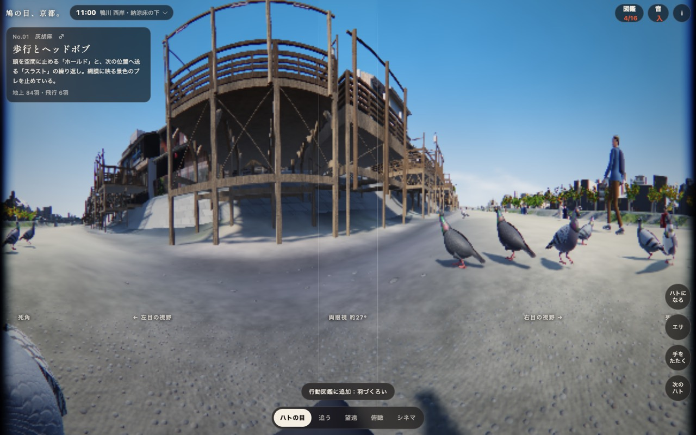
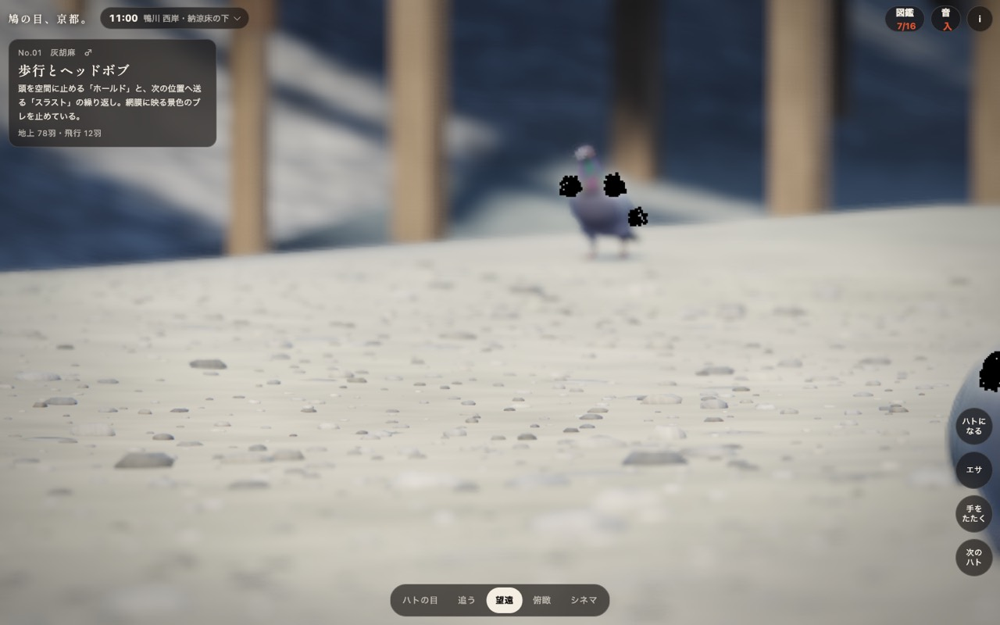
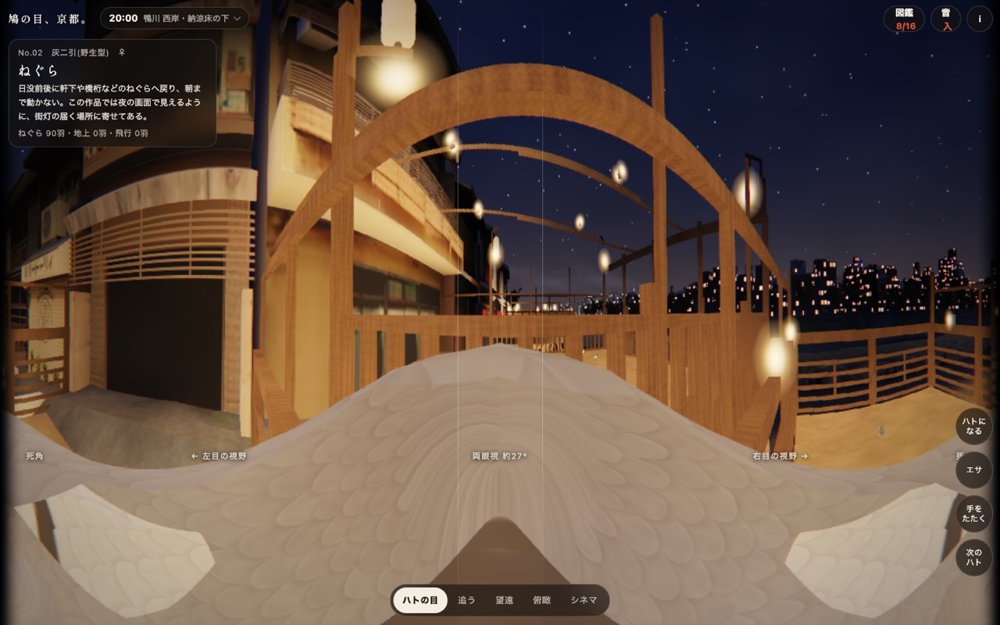
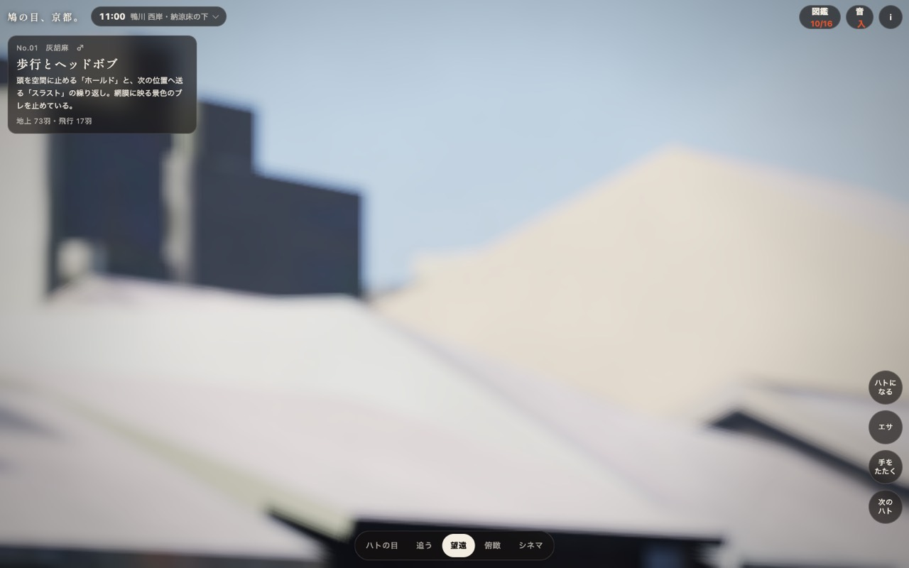

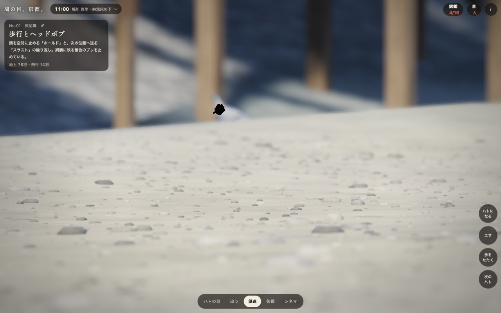
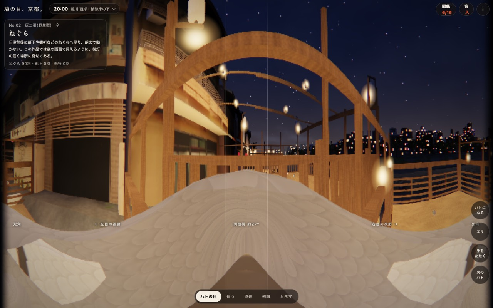
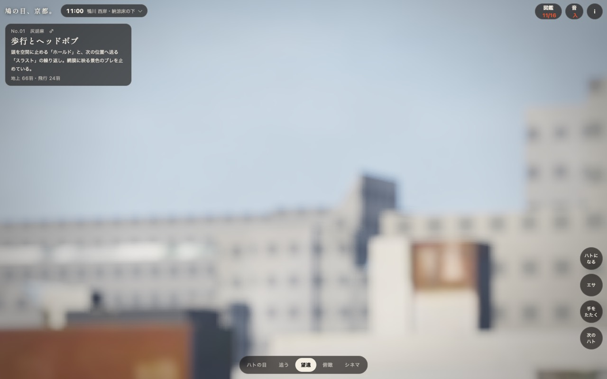

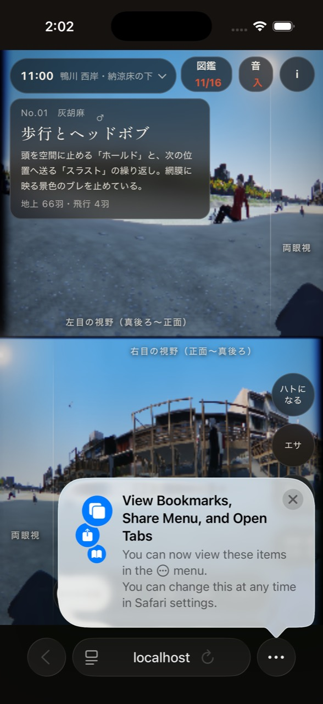
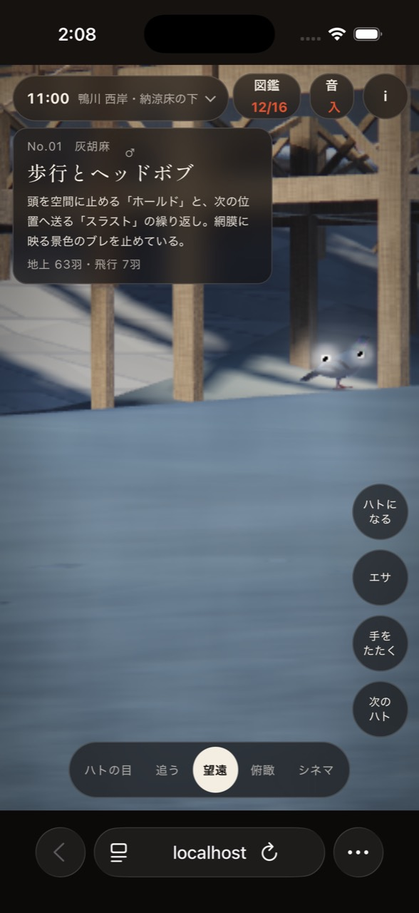
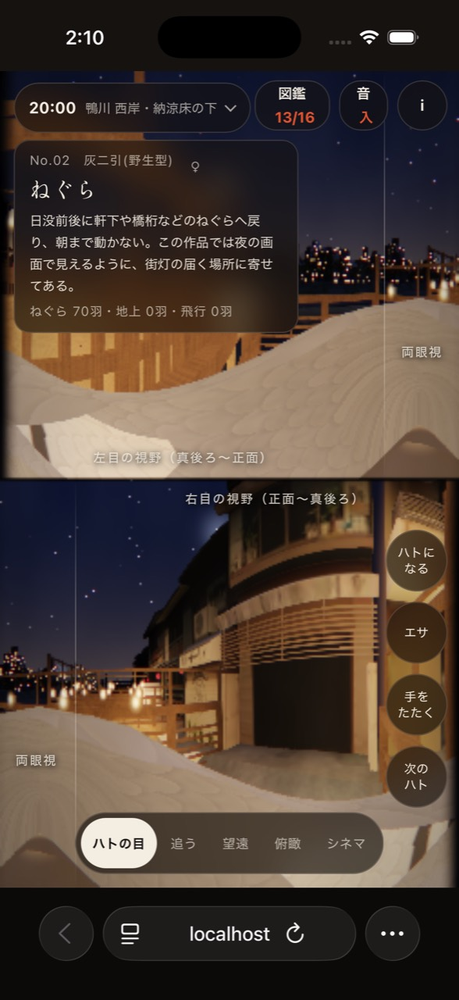
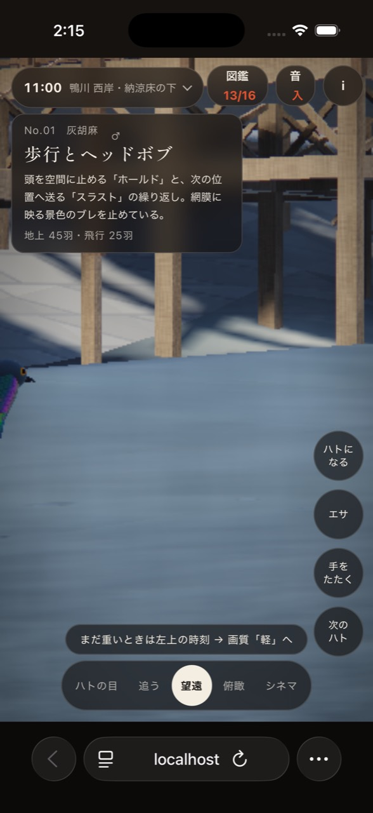

数値は作品自身が 1 秒ごとに出す 1 コマの平均です。iOS はシミュレーターで、実機ではありません。
