## 自動計測 ��2026-11-15 02:53 UTC、コミット 90e8bbe）

ランナー: macOS 15.8.2／

### macOS の Chrome

- レンダラー: `ANGLE (Apple, ANGLE Metal Renderer: Apple Paravirtual device, Unspecified Version)`
- 画面: 1440x900（倍率 1）／タッチ点: 0
- ブラウザ: `Mozilla/5.0 (Macintosh; Intel Mac OS X 10_15_7) AppleWebKit/537.36 (KHTML, like Gecko) Chrome/157.0.0.0 Safari/537.36`
- 浮動小数の描画先: あり／音の API: available／深度の比較サンプラー: {"complete": true, "lit": 1, "shadowed": 0, "ok": true}

| 条件 | 1コマ（中央値） | 最大 | 換算 | 内部解像度 | 描画の大きさ | 画質 | 軽量化 | 描画命令 | 三角形 | 起動 | エラー |
|---|---|---|---|---|---|---|---|---|---|---|---|
| ハトの目・昼 | 43.48 ms | 50 ms | 23 fps | 42% | 605x378 | 高 | あり | 929 | 9,812,909 | 9.624 秒 | 0 |
| 追う・昼 | 23.62 ms | 25.27 ms | 42 fps | 85% | 1224x765 | 高 | なし | 448 | 5,539,641 | 6.839 秒 | 0 |
| 俯瞰・昼 | 21.3 ms | 22.76 ms | 47 fps | 85% | 1224x765 | 高 | なし | 260 | 4,558,650 | 3.068 秒 | 0 |
| 望遠・昼 | 18.81 ms | 20 ms | 53 fps | 85% | 1224x765 | 高 | なし | 318 | 5,059,833 | 2.817 秒 | 0 |
| シネマ・昼 | 21.74 ms | 47.7 ms | 46 fps | 72% | 1040x650 | 高 | なし | 185 | 2,735,141 | 4.193 秒 | 0 |
| ハトの目・夜 | 31.25 ms | 34.45 ms | 32 fps | 55% | 792x495 | 高 | なし | 942 | 9,357,785 | 2.56 秒 | 0 |
| 望遠・夜 | 19.55 ms | 23.11 ms | 51 fps | 85% | 1224x765 | 高 | なし | 262 | 3,428,428 | 4.287 秒 | 0 |
| ハトの目・昼・読み込みデータの人 | 64.71 ms | 106.46 ms | 15 fps | 42% | 605x378 | 高 | あり | 2657 | 8,834,651 | 5.089 秒 | 0 |
| 望遠・昼・読み込みデータの人 | 26.32 ms | 31.32 ms | 38 fps | 72% | 1040x650 | 高 | なし | 961 | 4,760,400 | 4.331 秒 | 0 |

### macOS の WebKit（Safari のエンジン）

- レンダラー: `Apple GPU`
- 画面: 1440x900（倍率 1）／タッチ点: 0
- ブラウザ: `Mozilla/5.0 (Macintosh; Intel Mac OS X 10_15_7) AppleWebKit/605.1.15 (KHTML, like Gecko) Version/27.2 Safari/605.1.15`
- 浮動小数の描画先: あり／音の API: available／深度の比較サンプラー: {"complete": true, "lit": 1, "shadowed": 0, "ok": true}

| 条件 | 1コマ（中央値） | 最大 | 換算 | 内部解像度 | 描画の大きさ | 画質 | 軽量化 | 描画命令 | 三角形 | 起動 | エラー |
|---|---|---|---|---|---|---|---|---|---|---|---|
| ハトの目・昼 | 報告なし | | | | | | | | | | |
| 追う・昼 | 22.93 ms | 29.91 ms | 44 fps | 85% | 1224x765 | 高 | なし | 448 | 5,539,821 | 12.691 秒 | 0 |
| 俯瞰・昼 | 18.59 ms | 19.76 ms | 54 fps | 94% | 1346x842 | 高 | なし | 260 | 4,558,454 | 5.268 秒 | 0 |
| 望遠・昼 | 17.91 ms | 19.08 ms | 56 fps | 100% | 1440x900 | 高 | なし | 318 | 5,059,233 | 5.694 秒 | 0 |
| シネマ・昼 | 17.77 ms | 34.79 ms | 56 fps | 100% | 1440x900 | 高 | なし | 292 | 4,868,166 | 5.586 秒 | 0 |
| ハトの目・夜 | 40.04 ms | 53.89 ms | 25 fps | 42% | 605x378 | 高 | あり | 789 | 7,942,211 | 5.354 秒 | 0 |
| 望遠・夜 | 18.13 ms | 23.75 ms | 55 fps | 94% | 1346x842 | 高 | なし | 262 | 3,428,388 | 5.571 秒 | 0 |
| ハトの目・昼・読み込みデータの人 | 56.28 ms | 67.8 ms | 18 fps | 42% | 605x378 | 高 | あり | 2659 | 8,749,386 | 6.59 秒 | 0 |
| 望遠・昼・読み込みデータの人 | 18.18 ms | 60.76 ms | 55 fps | 85% | 1224x765 | 高 | なし | 964 | 4,684,409 | 6.605 秒 | 0 |

### iOS シミュレーターの Safari

- 機種: iPhone 17（iOS-26-2）。**シミュレーターであり実機ではありません。** 描画はホストの Mac の GPU が行います
- レンダラー: `Apple GPU`
- 画面: 402x714（倍率 3）／タッチ点: 5
- ブラウザ: `Mozilla/5.0 (iPhone; CPU iPhone OS 18_7 like Mac OS X) AppleWebKit/605.1.15 (KHTML, like Gecko) Version/26.2 Mobile/15E148 Safari/604.1`
- 浮動小数の描画先: あり／音の API: available／深度の比較サンプラー: {"complete": true, "lit": 0, "shadowed": 0, "ok": false}

| 条件 | 1コマ（中央値） | 最大 | 換算 | 内部解像度 | 描画の大きさ | 画質 | 軽量化 | 描画命令 | 三角形 | 起動 | エラー |
|---|---|---|---|---|---|---|---|---|---|---|---|
| ハトの目・昼 | 114.3 ms | 149 ms | 9 fps | 32% | 253x450 | 中 | あり | 780 | 7,672,403 | 36.761 秒 | 0 |
| 追う・昼 | 27.54 ms | 32.52 ms | 36 fps | 46% | 370x658 | 中 | なし | 227 | 2,464,122 | 10.814 秒 | 0 |
| 俯瞰・昼 | 31.24 ms | 38.92 ms | 32 fps | 41% | 332x589 | 中 | なし | 155 | 2,054,063 | 10.337 秒 | 0 |
| 望遠・昼 | 31.55 ms | 42.08 ms | 32 fps | 41% | 332x589 | 中 | なし | 96 | 1,660,489 | 8.962 秒 | 0 |
| シネマ・昼 | 67 ms | 87 ms | 15 fps | 41% | 332x589 | 中 | なし | 789 | 7,926,108 | 9.793 秒 | 0 |
| ハトの目・夜 | 63.13 ms | 70.6 ms | 16 fps | 32% | 253x450 | 中 | あり | 782 | 7,295,014 | 10.461 秒 | 0 |
| 望遠・夜 | 27.05 ms | 29.94 ms | 37 fps | 54% | 436x774 | 中 | なし | 175 | 1,772,136 | 10.954 秒 | 0 |
| ハトの目・昼・読み込みデータの人 | 111.33 ms | 125.56 ms | 9 fps | 32% | 253x450 | 中 | あり | 2649 | 8,136,113 | 13.788 秒 | 0 |
| 望遠・昼・読み込みデータの人 | 35.79 ms | 45.64 ms | 28 fps | 32% | 253x450 | 中 | あり | 360 | 1,752,124 | 15.704 秒 | 0 |
| 俯瞰・昼・ハトの影なし | 21.19 ms | 22.73 ms | 47 fps | 64% | 513x910 | 中 | なし | 54 | 1,108,037 | 7.975 秒 | 0 |
| 俯瞰・昼・画質高指定 | 29.88 ms | 32.28 ms | 33 fps | 55% | 332x589 | 高 | なし | 234 | 4,443,347 | 14.909 秒 | 0 |
| 俯瞰・昼・画質軽指定 | 19.94 ms | 25.82 ms | 50 fps | 51% | 410x728 | 軽 | なし | 113 | 1,216,812 | 8.752 秒 | 0 |

### 画面

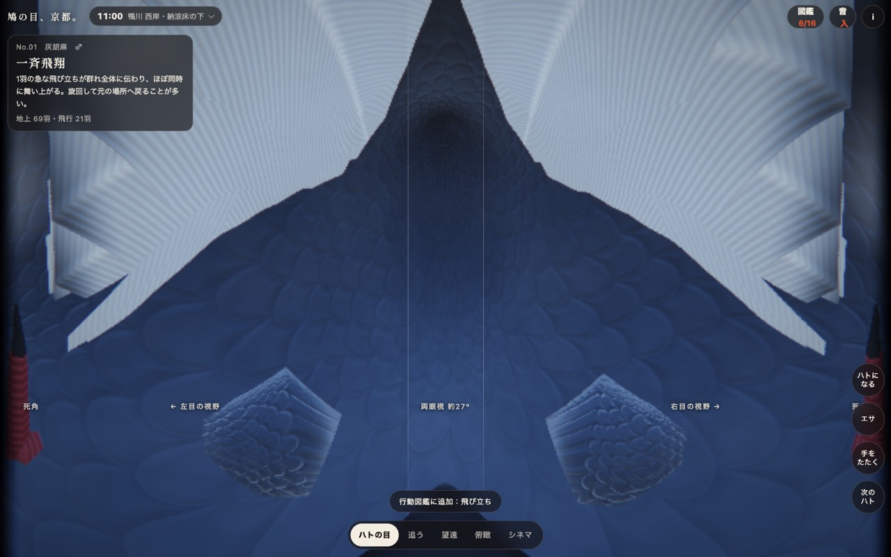
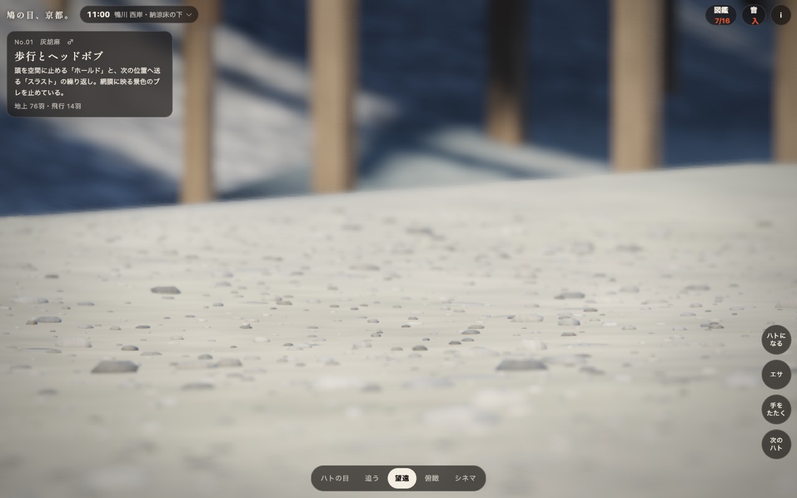
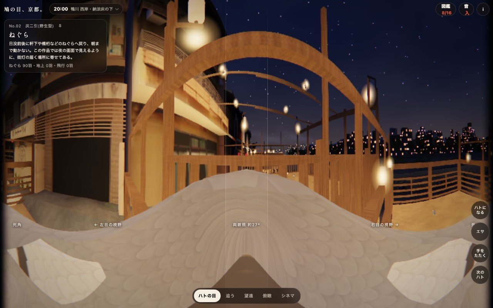
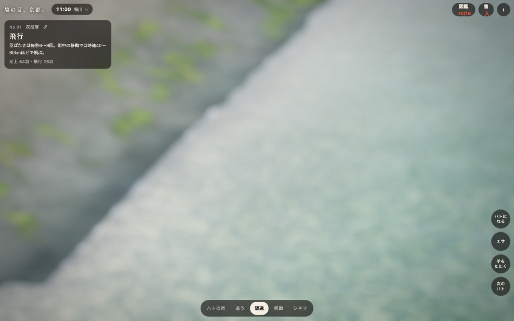

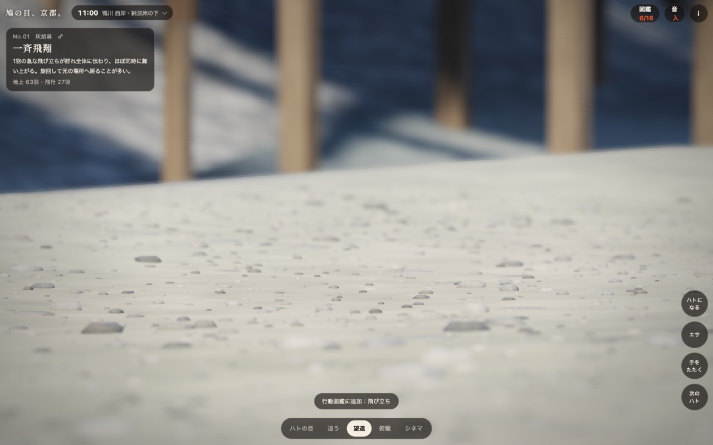
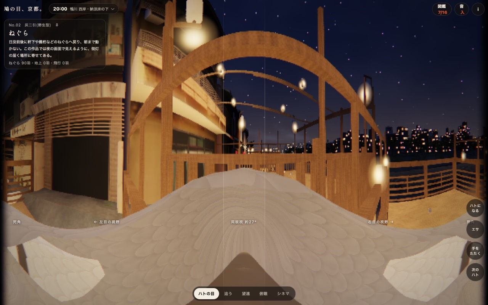
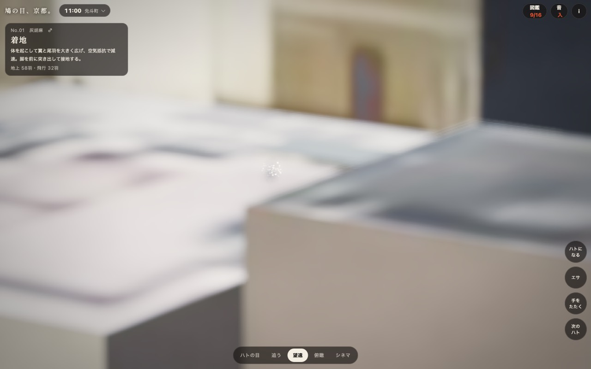

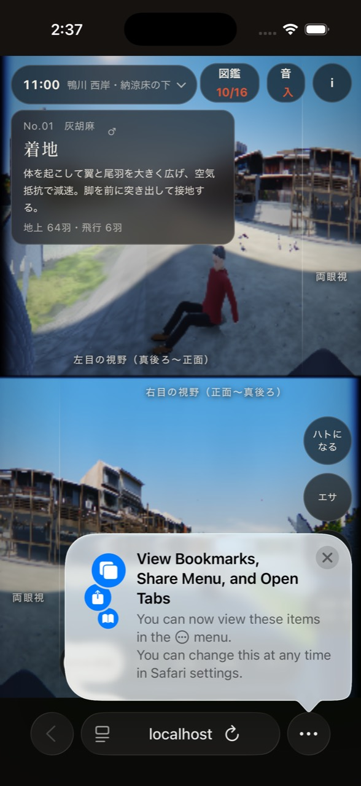
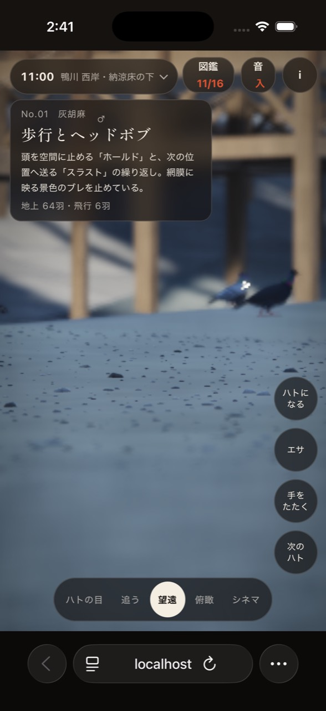
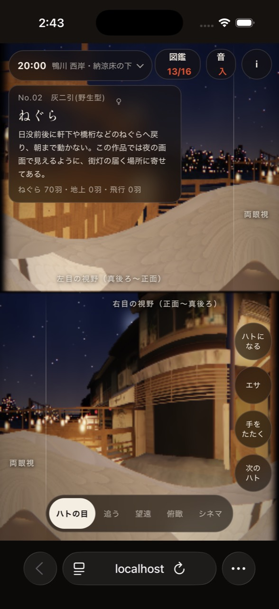
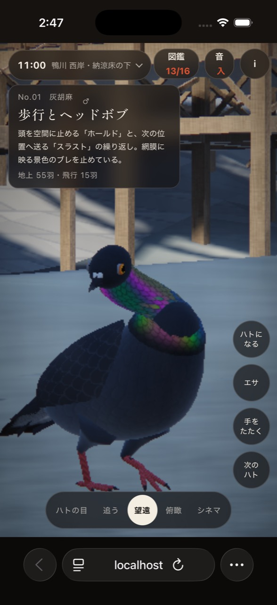

数値は作品自身が 1 秒ごとに出す 1 コマの平均です。iOS はシミュレーターで、実機ではありません。
