## 自動計測 ��2026-11-15 03:32 UTC、コミット d599045）

ランナー: macOS 15.8.2／

### macOS の Chrome

- レンダラー: `ANGLE (Apple, ANGLE Metal Renderer: Apple Paravirtual device, Unspecified Version)`
- 画面: 1440x900（倍率 1）／タッチ点: 0
- ブラウザ: `Mozilla/5.0 (Macintosh; Intel Mac OS X 10_15_7) AppleWebKit/537.36 (KHTML, like Gecko) Chrome/157.0.0.0 Safari/537.36`
- 浮動小数の描画先: あり／音の API: available／深度の比較サンプラー: {"complete": true, "lit": 1, "shadowed": 0, "ok": true}

| 条件 | 1コマ（中央値） | 最大 | 換算 | 内部解像度 | 描画の大きさ | 画質 | 軽量化 | 描画命令 | 三角形 | 起動 | エラー |
|---|---|---|---|---|---|---|---|---|---|---|---|
| ハトの目・昼 | 57.42 ms | 59.7 ms | 17 fps | 42% | 605x378 | 高 | あり | 786 | 8,289,623 | 14.605 秒 | 0 |
| 追う・昼 | 28.24 ms | 30.82 ms | 35 fps | 61% | 884x553 | 高 | なし | 451 | 5,568,751 | 9.046 秒 | 0 |
| 俯瞰・昼 | 31.32 ms | 35.07 ms | 32 fps | 55% | 792x495 | 高 | あり | 127 | 2,606,685 | 8.166 秒 | 0 |
| 望遠・昼 | 24.16 ms | 24.8 ms | 41 fps | 72% | 1040x650 | 高 | なし | 318 | 5,060,709 | 4.1 秒 | 0 |
| シネマ・昼 | 34.91 ms | 129.85 ms | 29 fps | 55% | 792x495 | 高 | なし | 273 | 4,694,781 | 4.108 秒 | 0 |
| ハトの目・夜 | 59.15 ms | 60.81 ms | 17 fps | 42% | 605x378 | 高 | あり | 789 | 7,941,131 | 6.054 秒 | 0 |
| 望遠・夜 | 25.69 ms | 30.75 ms | 39 fps | 85% | 1224x765 | 高 | なし | 265 | 3,456,798 | 3.94 秒 | 0 |
| ハトの目・昼・読み込みデータの人 | 61.76 ms | 101.5 ms | 16 fps | 42% | 605x378 | 高 | あり | 2667 | 8,903,290 | 6.901 秒 | 0 |
| 望遠・昼・読み込みデータの人 | 31.82 ms | 43.34 ms | 31 fps | 61% | 884x553 | 高 | なし | 991 | 4,908,407 | 4.544 秒 | 0 |

注視中のハトの位置: **画面の外に出た時点あり**
- chase_day: 3/8 回、注視中のハトが画面の外（例 画面座標 [1.16, 0.34]、距離 2.85 m、飛行中=False、視点の選び直し 0 回）
- over_day: 1/8 回、注視中のハトが画面の外（例 画面座標 [-0.28, -1.04]、距離 7.69 m、飛行中=False、視点の選び直し 0 回）
- tele_day: 3/8 回、注視中のハトが画面の外（例 画面座標 [3.18, 0.37]、距離 7.45 m、飛行中=False、視点の選び直し 0 回）
- tele_day_asset: 7/8 回、注視中のハトが画面の外（例 画面座標 [-1.79, 1.82]、距離 13.29 m、飛行中=True、視点の選び直し 0 回）

### macOS の WebKit（Safari のエンジン）

- レンダラー: `Apple GPU`
- 画面: 1440x900（倍率 1）／タッチ点: 0
- ブラウザ: `Mozilla/5.0 (Macintosh; Intel Mac OS X 10_15_7) AppleWebKit/605.1.15 (KHTML, like Gecko) Version/27.2 Safari/605.1.15`
- 浮動小数の描画先: あり／音の API: available／深度の比較サンプラー: {"complete": true, "lit": 1, "shadowed": 0, "ok": true}

| 条件 | 1コマ（中央値） | 最大 | 換算 | 内部解像度 | 描画の大きさ | 画質 | 軽量化 | 描画命令 | 三角形 | 起動 | エラー |
|---|---|---|---|---|---|---|---|---|---|---|---|
| ハトの目・昼 | 報告なし | | | | | | | | | | |
| 追う・昼 | 20.3 ms | 21.28 ms | 49 fps | 72% | 1040x650 | 高 | なし | 448 | 5,539,041 | 12.692 秒 | 0 |
| 俯瞰・昼 | 18.91 ms | 20.2 ms | 53 fps | 94% | 1346x842 | 高 | なし | 260 | 4,558,454 | 5.756 秒 | 0 |
| 望遠・昼 | 16.7 ms | 17.86 ms | 60 fps | 94% | 1346x842 | 高 | なし | 318 | 5,059,433 | 5.706 秒 | 0 |
| シネマ・昼 | 18.44 ms | 45.59 ms | 54 fps | 94% | 1346x842 | 高 | なし | 269 | 4,479,098 | 4.974 秒 | 0 |
| ハトの目・夜 | 39.73 ms | 42.29 ms | 25 fps | 42% | 605x378 | 高 | あり | 789 | 7,942,691 | 5.236 秒 | 0 |
| 望遠・夜 | 16.67 ms | 16.95 ms | 60 fps | 100% | 1440x900 | 高 | なし | 262 | 3,428,308 | 5.369 秒 | 0 |
| ハトの目・昼・読み込みデータの人 | 47.27 ms | 86.85 ms | 21 fps | 42% | 605x378 | 高 | あり | 2642 | 8,812,221 | 6.107 秒 | 0 |
| 望遠・昼・読み込みデータの人 | 20.88 ms | 46.27 ms | 48 fps | 85% | 1224x765 | 高 | なし | 982 | 4,815,096 | 6.926 秒 | 0 |

注視中のハトの位置: **画面の外に出た時点あり**
- chase_day: 5/8 回、注視中のハトが画面の外（例 画面座標 [2.67, -1.99]、距離 -24.21 m、飛行中=True、視点の選び直し 0 回）
- tele_day: 8/8 回、注視中のハトが画面の外（例 画面座標 [6.16, 0.53]、距離 6.92 m、飛行中=False、視点の選び直し 0 回）
- tele_day_asset: 7/8 回、注視中のハトが画面の外（例 画面座標 [5.58, 0.99]、距離 15.6 m、飛行中=True、視点の選び直し 0 回）

### iOS シミュレーターの Safari

- 機種: iPhone 17（iOS-26-2）。**シミュレーターであり実機ではありません。** 描画はホストの Mac の GPU が行います
- レンダラー: `Apple GPU`
- 画面: 402x714（倍率 3）／タッチ点: 5
- ブラウザ: `Mozilla/5.0 (iPhone; CPU iPhone OS 18_7 like Mac OS X) AppleWebKit/605.1.15 (KHTML, like Gecko) Version/26.2 Mobile/15E148 Safari/604.1`
- 浮動小数の描画先: あり／音の API: available／深度の比較サンプラー: {"complete": true, "lit": 0, "shadowed": 0, "ok": false}

| 条件 | 1コマ（中央値） | 最大 | 換算 | 内部解像度 | 描画の大きさ | 画質 | 軽量化 | 描画命令 | 三角形 | 起動 | エラー |
|---|---|---|---|---|---|---|---|---|---|---|---|
| ハトの目・昼 | 140 ms | 213.2 ms | 7 fps | 32% | 253x450 | 中 | あり | 780 | 7,560,342 | 54.877 秒 | 0 |
| 追う・昼 | 50.45 ms | 71.64 ms | 20 fps | 32% | 253x450 | 中 | あり | 225 | 2,422,059 | 12.721 秒 | 0 |
| 俯瞰・昼 | 29.79 ms | 39.62 ms | 34 fps | 54% | 436x774 | 中 | なし | 55 | 1,488,799 | 10.476 秒 | 0 |
| 望遠・昼 | 41.83 ms | 55.72 ms | 24 fps | 32% | 253x450 | 中 | あり | 94 | 1,618,828 | 11.699 秒 | 0 |
| シネマ・昼 | 50.67 ms | 150.43 ms | 20 fps | 32% | 253x450 | 中 | あり | 67 | 1,412,570 | 10.867 秒 | 0 |
| ハトの目・夜 | 107.7 ms | 141 ms | 9 fps | 32% | 253x450 | 中 | あり | 782 | 7,293,574 | 15.078 秒 | 0 |
| 望遠・夜 | 48.52 ms | 67.6 ms | 21 fps | 32% | 253x450 | 中 | あり | 67 | 1,181,572 | 16.188 秒 | 0 |
| ハトの目・昼・読み込みデータの人 | 276.75 ms | 316.5 ms | 4 fps | 32% | 253x450 | 中 | あり | 3075 | 8,845,534 | 25.844 秒 | 0 |
| 望遠・昼・読み込みデータの人 | 72.86 ms | 95.73 ms | 14 fps | 32% | 253x450 | 中 | あり | 724 | 2,324,068 | 18.219 秒 | 0 |
| 俯瞰・昼・ハトの影なし | 43.96 ms | 56.06 ms | 23 fps | 32% | 253x450 | 中 | あり | 52 | 1,066,256 | 13.502 秒 | 0 |
| 俯瞰・昼・画質高指定 | 84.62 ms | 106.6 ms | 12 fps | 47% | 282x501 | 高 | あり | 101 | 2,494,738 | 30.181 秒 | 0 |
| 俯瞰・昼・画質軽指定 | 52 ms | 84 ms | 19 fps | 25% | 203x360 | 軽 | あり | 50 | 975,336 | 11.772 秒 | 0 |

注視中のハトの位置: **画面の外に出た時点あり**
- chase_day: 8/8 回、注視中のハトが画面の外（例 画面座標 [-6.29, 0.19]、距離 0.94 m、飛行中=False、視点の選び直し 0 回）
- over_day: 5/8 回、注視中のハトが画面の外（例 画面座標 [-2.2, -0.21]、距離 9.26 m、飛行中=False、視点の選び直し 0 回）
- tele_day: 8/8 回、注視中のハトが画面の外（例 画面座標 [5.63, 0.2]、距離 7.22 m、飛行中=False、視点の選び直し 0 回）
- tele_day_asset: 8/8 回、注視中のハトが画面の外（例 画面座標 [3.32, 0.11]、距離 6.24 m、飛行中=False、視点の選び直し 0 回）
- over_day_nobsh: 8/8 回、注視中のハトが画面の外（例 画面座標 [1.95, 0.13]、距離 10.34 m、飛行中=False、視点の選び直し 0 回）
- over_day_low: 4/8 回、注視中のハトが画面の外（例 画面座標 [1.68, 0.27]、距離 10.62 m、飛行中=False、視点の選び直し 0 回）

### 画面

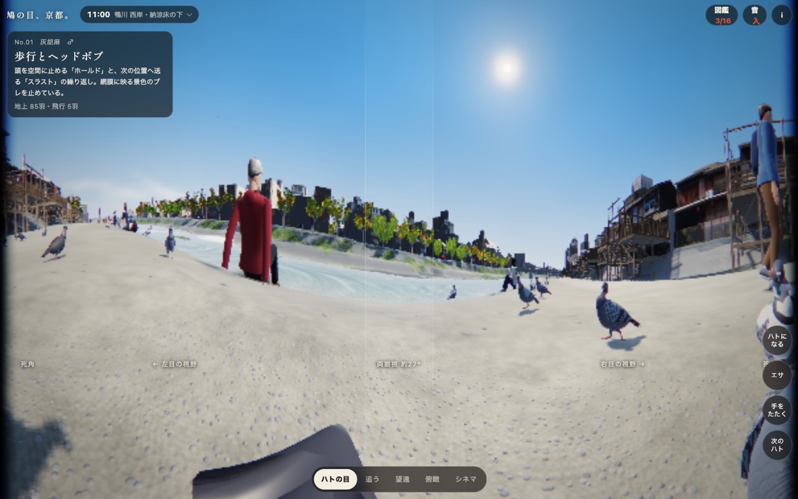
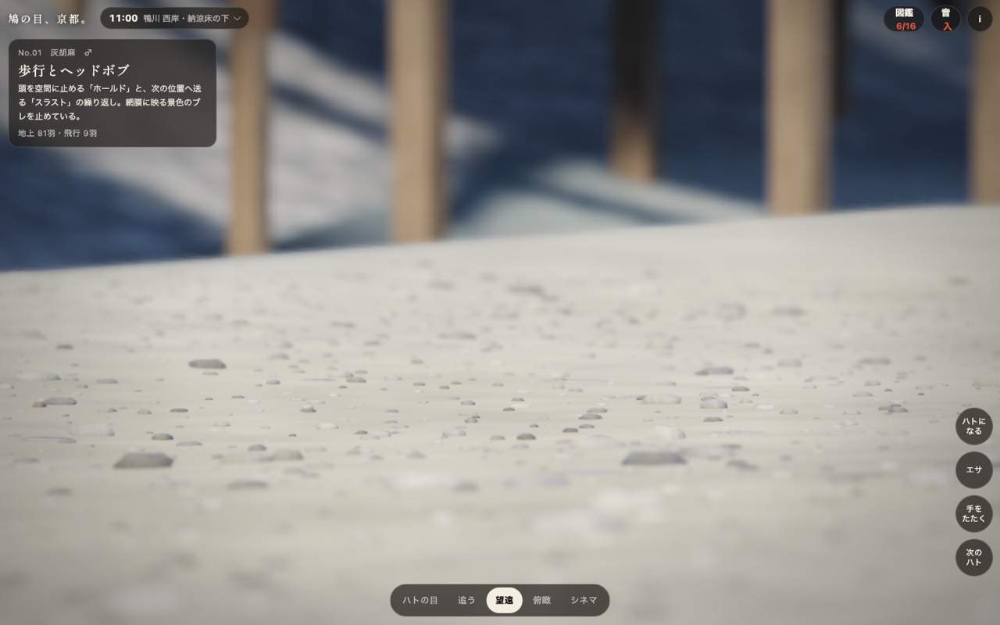
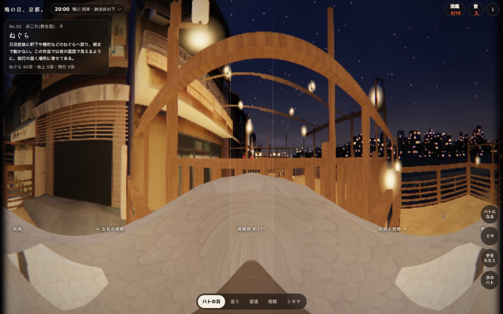
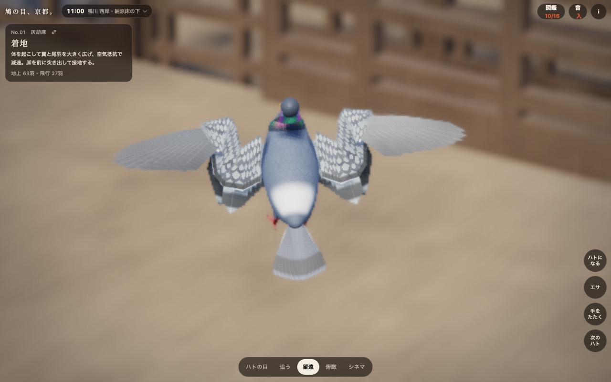

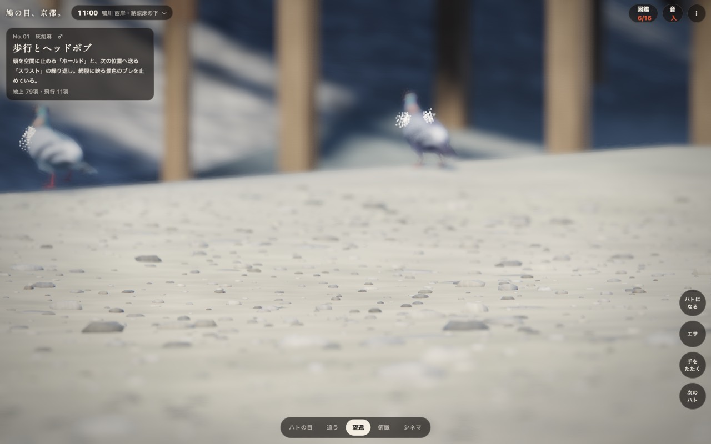
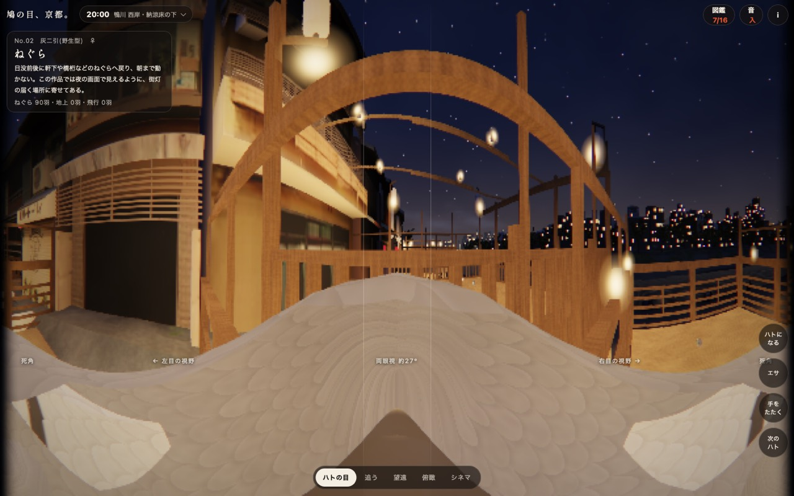
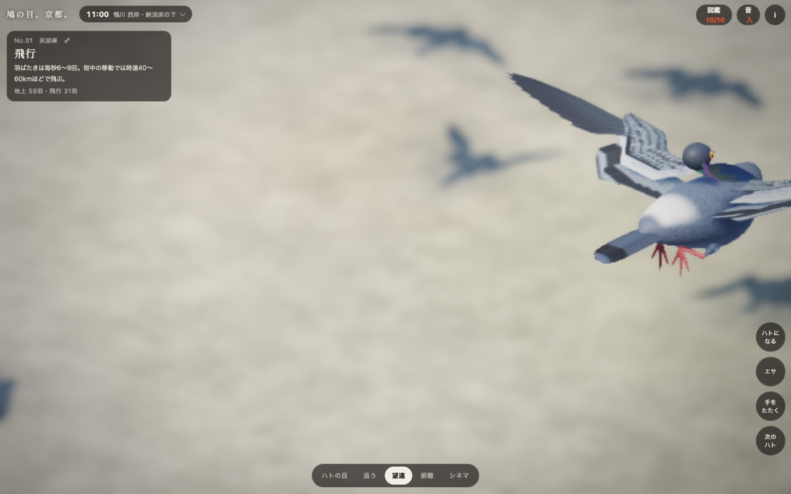

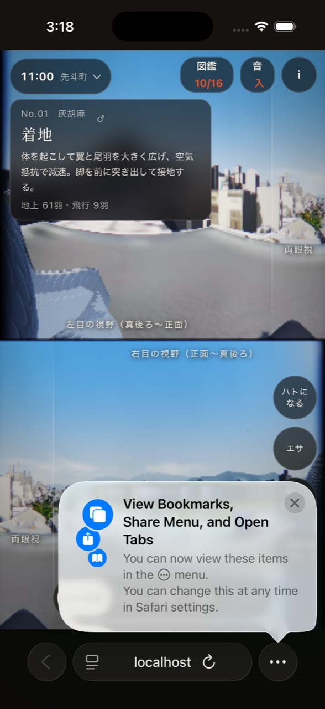
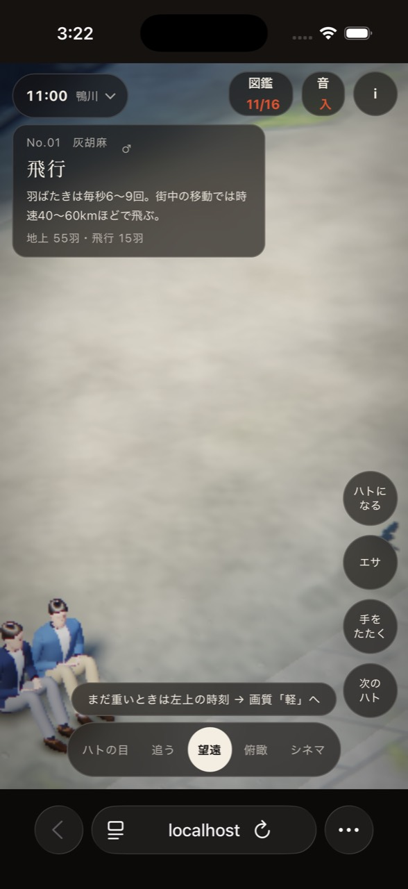
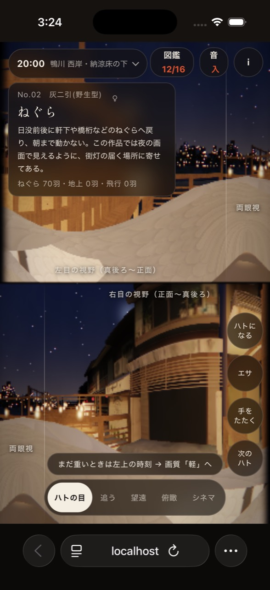
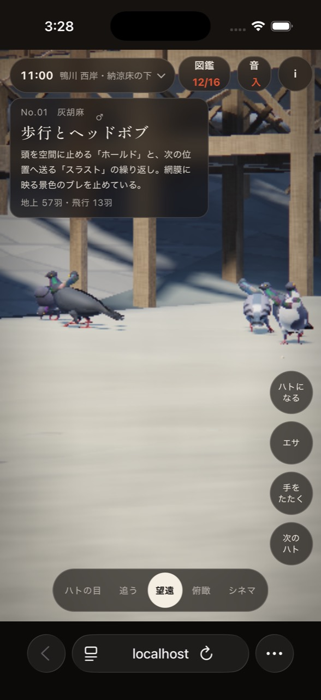

数値は作品自身が 1 秒ごとに出す 1 コマの平均です。iOS はシミュレーターで、実機ではありません。
