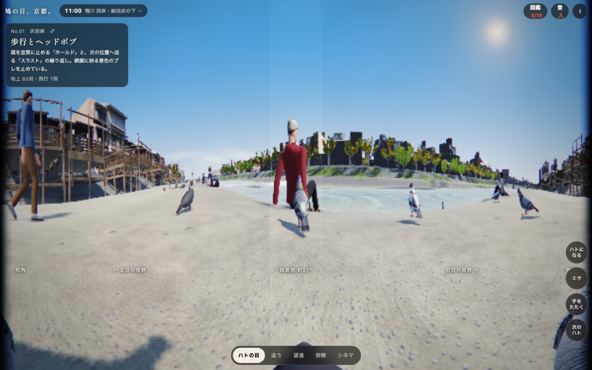
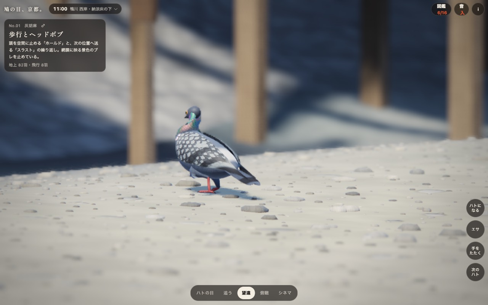
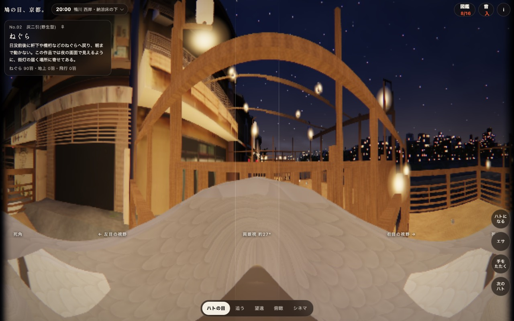
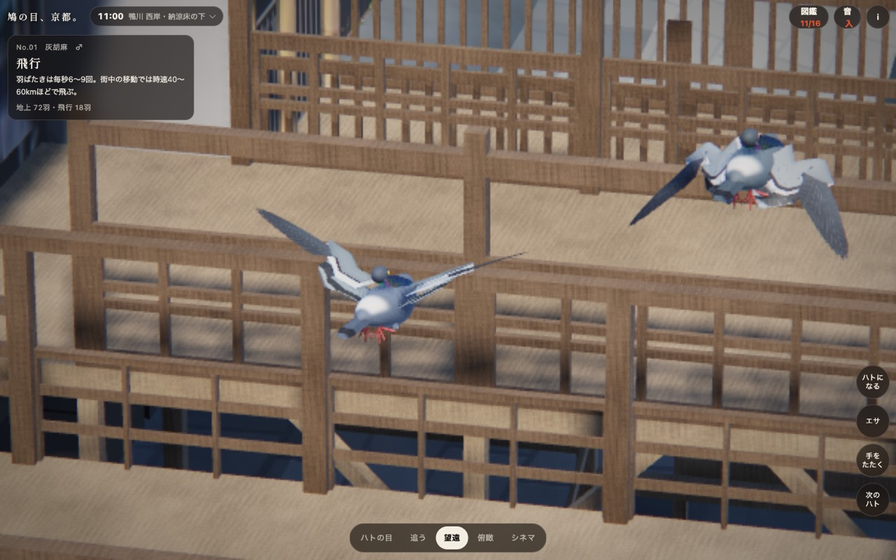
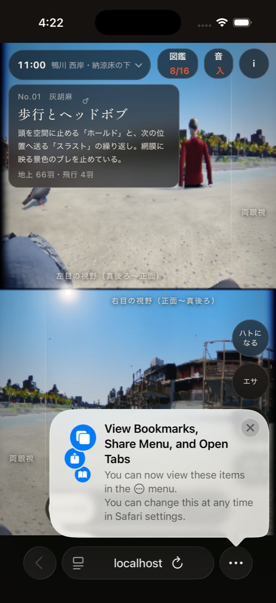
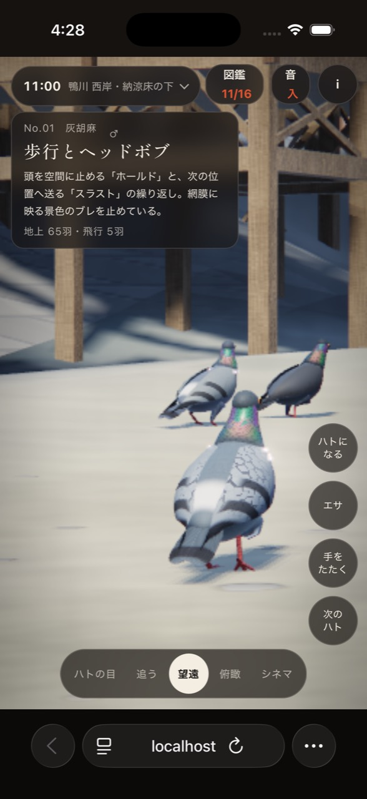
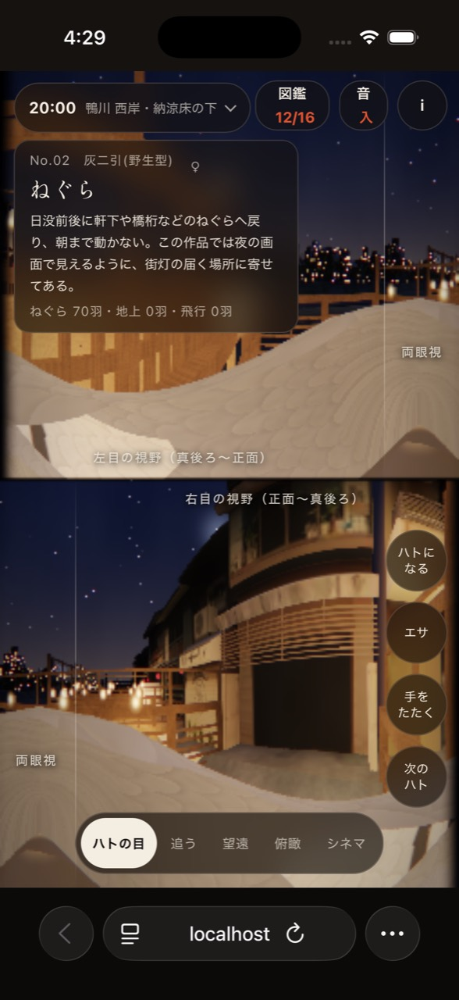
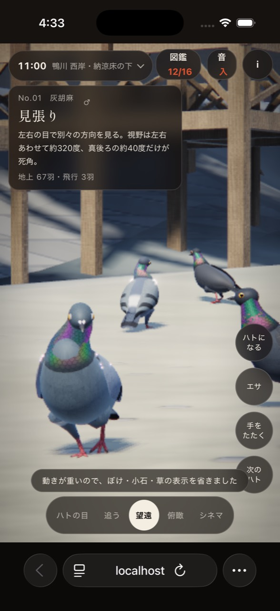

## 自動計測 ��2026-11-15 04:36 UTC、コミット 5576f97）

ランナー: macOS 15.8.2／

### macOS の Chrome

- レンダラー: `ANGLE (Apple, ANGLE Metal Renderer: Apple Paravirtual device, Unspecified Version)`
- 画面: 1440x900（倍率 1）／タッチ点: 0
- ブラウザ: `Mozilla/5.0 (Macintosh; Intel Mac OS X 10_15_7) AppleWebKit/537.36 (KHTML, like Gecko) Chrome/157.0.0.0 Safari/537.36`
- 浮動小数の描画先: あり／音の API: available／深度の比較サンプラー: {"complete": true, "lit": 1, "shadowed": 0, "ok": true}

| 条件 | 1コマ（中央値） | 最大 | 換算 | 内部解像度 | 描画の大きさ | 画質 | 軽量化 | 描画命令 | 三角形 | 起動 | エラー |
|---|---|---|---|---|---|---|---|---|---|---|---|
| ハトの目・昼 | 60.65 ms | 84.72 ms | 16 fps | 42% | 605x378 | 高 | あり | 786 | 8,290,103 | 13.308 秒 | 0 |
| 追う・昼 | 21.62 ms | 24.8 ms | 46 fps | 72% | 1040x650 | 高 | なし | 408 | 5,313,890 | 8.567 秒 | 0 |
| 俯瞰・昼 | 30.06 ms | 32.23 ms | 33 fps | 72% | 1040x650 | 高 | なし | 242 | 4,358,879 | 3.325 秒 | 0 |
| 望遠・昼 | 25.64 ms | 39.57 ms | 39 fps | 61% | 884x553 | 高 | なし | 313 | 5,016,666 | 3.334 秒 | 0 |
| シネマ・昼 | 35.63 ms | 58.77 ms | 28 fps | 55% | 792x495 | 高 | あり | 105 | 2,305,718 | 4.578 秒 | 0 |
| ハトの目・夜 | 52.53 ms | 68.85 ms | 19 fps | 47% | 673x421 | 高 | あり | 789 | 7,941,131 | 4.215 秒 | 0 |
| 望遠・夜 | 34.48 ms | 44.2 ms | 29 fps | 55% | 792x495 | 高 | あり | 126 | 2,229,197 | 3.454 秒 | 0 |
| ハトの目・昼・読み込みデータの人 | 101.62 ms | 118.52 ms | 10 fps | 42% | 605x378 | 高 | あり | 2651 | 8,827,280 | 7.098 秒 | 0 |
| 望遠・昼・読み込みデータの人 | 43.06 ms | 92.66 ms | 23 fps | 42% | 605x378 | 高 | あり | 637 | 3,037,205 | 9.084 秒 | 0 |

注視中のハトの位置: すべての計測時点で画面内

### iOS シミュレーターの Safari

- 機種: iPhone 17（iOS-26-2）。**シミュレーターであり実機ではありません。** 描画はホストの Mac の GPU が行います
- レンダラー: `Apple GPU`
- 画面: 402x714（倍率 3）／タッチ点: 5
- ブラウザ: `Mozilla/5.0 (iPhone; CPU iPhone OS 18_7 like Mac OS X) AppleWebKit/605.1.15 (KHTML, like Gecko) Version/26.2 Mobile/15E148 Safari/604.1`
- 浮動小数の描画先: あり／音の API: available／深度の比較サンプラー: {"complete": true, "lit": 0, "shadowed": 0, "ok": false}

| 条件 | 1コマ（中央値） | 最大 | 換算 | 内部解像度 | 描画の大きさ | 画質 | 軽量化 | 描画命令 | 三角形 | 起動 | エラー |
|---|---|---|---|---|---|---|---|---|---|---|---|
| ハトの目・昼 | 155 ms | 285.75 ms | 6 fps | 32% | 253x450 | 中 | あり | 776 | 7,536,848 | 35.241 秒 | 0 |
| 追う・昼 | 43.52 ms | 115.67 ms | 23 fps | 32% | 253x450 | 中 | あり | 107 | 1,644,092 | 11.49 秒 | 0 |
| 俯瞰・昼 | 30.67 ms | 60.82 ms | 33 fps | 46% | 370x658 | 中 | なし | 56 | 1,470,981 | 8.822 秒 | 0 |
| 望遠・昼 | 28.14 ms | 32.19 ms | 36 fps | 46% | 370x658 | 中 | なし | 196 | 2,342,725 | 9.538 秒 | 0 |
| シネマ・昼 | 67.53 ms | 1000 ms | 15 fps | 32% | 253x450 | 中 | あり | 123 | 1,770,330 | 10.899 秒 | 0 |
| ハトの目・夜 | 97.82 ms | 108.1 ms | 10 fps | 32% | 253x450 | 中 | あり | 782 | 7,293,574 | 10.799 秒 | 0 |
| 望遠・夜 | 45 ms | 48.67 ms | 22 fps | 35% | 282x501 | 中 | あり | 67 | 1,181,652 | 9.626 秒 | 0 |
| ハトの目・昼・読み込みデータの人 | 166.67 ms | 214.4 ms | 6 fps | 32% | 253x450 | 中 | あり | 3075 | 8,843,559 | 18.785 秒 | 0 |
| 望遠・昼・読み込みデータの人 | 68.07 ms | 89.42 ms | 15 fps | 35% | 282x501 | 中 | あり | 332 | 1,741,295 | 16.825 秒 | 0 |
| 俯瞰・昼・ハトの影なし | 28.24 ms | 30.79 ms | 35 fps | 64% | 513x910 | 中 | なし | 161 | 1,687,531 | 18.333 秒 | 0 |
| 俯瞰・昼・画質高指定 | 63.81 ms | 85.5 ms | 16 fps | 42% | 253x450 | 高 | あり | 100 | 2,471,855 | 24.988 秒 | 0 |
| 俯瞰・昼・画質軽指定 | 23.65 ms | 25.64 ms | 42 fps | 51% | 410x728 | 軽 | なし | 51 | 971,093 | 10.495 秒 | 0 |

注視中のハトの位置: **画面の外に出た時点あり**
- over_day_nobsh: 4/8 回、注視中のハトが画面の外（例 画面座標 [5.89, 0.65]、距離 6.37 m、飛行中=True、視点の選び直し 0 回）

### 画面

数値は作品自身が 1 秒ごとに出す 1 コマの平均です。iOS はシミュレーターで、実機ではありません。
